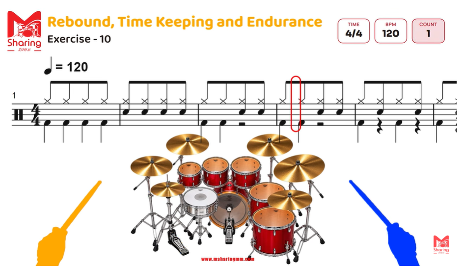

# M Sharing Website — Development Plan

> ## ⚠ အရေးအကြီးဆုံး သတိပေးချက် — Video Engine နှင့် shared code
>
> **Video Engine** သည် instrument အားလုံး (Drum, Piano, Guitar နှင့် နောက်ထပ်ထည့်မည့်ဟာများ) အတွက် တူညီသော common အလုပ်ကို လုပ်ပေးရမည်။ Page တစ်ခုချင်းစီ (`studio.html`, `studio-*.js` စသည်) ထဲတွင် ပြန့်ကျဲနေသော shared code များကို သက်ဆိုင်ရာ Engine ထဲသို့ ရွှေ့ရမည်။ ရွှေ့ပြီးနောက် code ကို ဂရုတစိုက် ပြန်လည်စစ်ဆေးရမည်။ Instrument တစ်ခုချင်းစီအတွက် common အလုပ်ကို feature folder ထဲတွင် ထပ်ရေးခြင်း/ကူးခြင်း မပြုရ။ (အသေးစိတ် placement rule — "Shared engine placement and reuse" ကို ကြည့်ပါ။)

## အကြောင်းအရာစာရင်း

- **အခြေခံ Plan:** ၁ ရည်ရွယ်ချက် / feature / engine architecture · ၂ Frontend · ၃ Backend · ၄ Storage · ၅ Deployment · ၆ AWS portability · ၇ အဆင့်များ · ၈ Testing · ၉ လက်ရှိအခြေအနေ (Header) · ၁၀ Git/Cloudflare · ၁၁ Doc workflow
- [Notation Lab Page — 2026-11-13](#notation-lab-page--2026-11-13) (အစောပိုင်း baseline)
- [Create Video — Engine workflow](#create-video--engine-workflow--2026-11-13) (Drum / Piano workflow)
- [Notation Lab UI/UX Plan](#notation-lab-uiux-plan--revised-2026-11-15)
- [Writer Engine — Notation Editor](#writer-engine--notation-editor--2026-11-22) (Inst. box၊ sidebar၊ palettes)
- [Create Video — Final video layout](#create-video--final-video-layout--2026-11-22) (၃ ပိုင်း layout)
- Create Video — Video ထုတ်လုပ်ပုံ အသေးစိတ် (pipeline၊ Studio options၊ engine တာဝန်ခွဲခြားမှု၊ ဆုံးဖြတ်ချက်များ၊ ပြီးစီးမှုအခြေအနေ)
- Sound Engine နှင့် MuseScore SoundFont (SoundFont ရွေးချယ်ချက် ပါ)
- Metronome Studio
- [Repository structure — folder rules](#repository-structure--folder-rules--2026-11-23) (Plan/Doc/SQL/Worker folder စည်းမျဉ်း)
- [Search — အလုပ်လုပ်ပုံ](#search--အလုပ်လုပ်ပုံ--2026-11-23) (Header search၊ Notes filter၊ Postgres full-text/trigram)
- [Handoff — Manus AI](#handoff--manus-ai-supabase-နှင့်-cloudflare-r2--2026-11-23) (Supabase data model၊ R2 layout၊ အလုပ်အစီအစဉ်)
- [Work packages — OpenHands](#work-packages--openhands-အတွက်-အစီအစဉ်အတိုင်း--2026-11-23) (Editor နှင့် Create Video အစဉ်လိုက် အလုပ်များ)
- **အခြား Plan များ:** [Video Engine Plan](../Video/Video%20Engine%20Plan/PLAN.md) · [Notation Plan](../Notation/Notation%20Plan/PLAN.md) · [Metronome Engine Plan](../Metronome/Metronome%20Engine%20Plan/PLAN.md) · [Sound Plan](../Notation/Sound%20Plan/README.md)

## 1. ရည်ရွယ်ချက်

M Sharing သည် music learning, music notes, online courses, video studio, library နှင့် user profile/dashboard များ ပါဝင်မည့် responsive web application ဖြစ်မည်။ လက်ရှိ repository ထဲတွင် Header Bar prototype ကိုသာ တည်ဆောက်ထားပြီး ဤ Plan သည် နောက်ပိုင်း frontend၊ backend၊ storage နှင့် deployment အဆင့်များအတွက် အခြေခံ architecture ဖြစ်သည်။

### 1.1 Feature ၄ ခု နှင့် revenue share

Web app တွင် အဓိက feature ၄ ခု ရှိသည် — **Notes ရောင်းခြင်း၊ Lessons တက်ခြင်း၊ Create Video နှင့် Music Notes ရေးခြင်း (Notation Lab/Editor)**။ Create Video နှင့် Notation Lab ကို အရင်ဆွေးနွေး/တည်ဆောက်ပြီး Notes Store နှင့် Lessons ကို နောက်မှ လုပ်မည်။

- **Notation Lab/Editor:** MuseScore ကဲ့သို့ notation ရေးနိုင်ရမည်။ Creator များသည် ရေးထားသောအရာကို web app ထဲတွင် ရောင်းချရန် list လုပ်နိုင်မည်။
- **Revenue share:** ရောင်းရသည့် sale တစ်ခုချင်းစီ၏ **၄၅%** ကို platform က ယူမည်။ ၎င်း ၄၅% ကို payment fee များ မနှုတ်မီ ရောင်းဈေးမှ တိုက်ရိုက်ယူမည်။
- **Create Video:** အသုံးပြုသူက MusicXML ဖိုင်ပေးပြီး Engine များကို အသုံးပြု၍ video ဖိုင်ထုတ်ပေးမည်။

### 1.2 Engine architecture

| Feature | အသုံးပြုမည့် Engine များ |
|---|---|
| Notation Editor | Notation Engine + Sound Engine + **Writer Engine** |
| Create Video | Notation Engine + Sound Engine + Video Engine + သက်ဆိုင်ရာ အခြား Engine များ (ဥပမာ instrument-specific engines) |

- **Notation Engine** — notation ကို ပြသသည်။ သီးခြား၊ မပြောင်းလဲဘဲ ရပ်တည်သည်။ Notation Editor နှင့် Create Video နှစ်ခုစလုံးက ၎င်းကို **ကိုယ်ပိုင်ဖြင့် တိုက်ရိုက်ခေါ်သုံးသည်**။
- **Sound Engine** — notation အတွက် audio (အသံ) ကို ထုတ်ပေးသည်။
- **Writer Engine** — Notation Editor ထဲတွင် လုပ်ဆောင်သမျှ — notation ကို ရေးပုံရေးနည်းနှင့် editor operation အားလုံးကို ပိုင်ဆိုင်သည်။
- **Video Engine** — video ထုတ်လုပ်ခြင်း (Create Video)။ Instrument အားလုံးအတွက် common အလုပ်ကို လုပ်သည် (အပေါ်ဆုံး သတိပေးချက်ကို ကြည့်ပါ)။

**ဆုံးဖြတ်ချက်:** Notation Editor သည် score ကို Create Video သို့ **တိုက်ရိုက် မပို့ပါ**။ ၎င်းတို့ နှစ်ခုကြား ချိတ်ဆက်မှုကို Notation Engine မှတစ်ဆင့်သာ သီးခြားစီ လုပ်ဆောင်သည်။ Writer Engine ၏ အသေးစိတ် (တည်နေရာ၊ API) ကို နောက်ထပ်ဆွေးနွေးပြီးမှ သတ်မှတ်မည်။

## 2. Frontend technology options

အောက်ပါ technologies များကို project အလိုက် အသုံးပြုနိုင်သော candidate options အဖြစ် ထည့်သွင်းစဉ်းစားမည်။ Framework အားလုံးကို application တစ်ခုတည်းထဲတွင် တပြိုင်နက် မသုံးဘဲ product requirements နှင့် team workflow အပေါ်မူတည်၍ primary frontend stack တစ်ခုကို ရွေးချယ်မည်။

| Technology | အသုံးပြုနိုင်သည့်နေရာ | Plan ထဲတွင် အခန်းကဏ္ဍ |
|---|---|---|
| React + Vite | Fast SPA, dashboard, interactive music tools | Primary SPA candidate |
| Next.js | SSR/SEO, routing, full-stack web features | SEO နှင့် server rendering လိုအပ်ပါက candidate |
| Svelte + SvelteKit | Lightweight၊ performance-focused application | Alternative frontend candidate |
| Vue + Nuxt | Structured Vue application, SSR/SEO | Alternative frontend candidate |
| Angular | Large team နှင့် strict enterprise architecture | Enterprise-scale alternative |
| Tailwind CSS | Responsive design system နှင့် reusable UI styling | Framework-independent styling layer |
| React Native Web | Web နှင့် mobile UI ကို component sharing လုပ်ရန် | Mobile roadmap ရှိပါက optional extension |

### Initial recommendation

ပထမဆုံး production frontend အတွက် **React + Vite + Tailwind CSS** ကို အဓိက candidate အဖြစ်ထားမည်။ Dashboard, course cards, music player controls နှင့် responsive Header/Sidebar များကို reusable components အဖြစ် ခွဲရေးရန် လွယ်ကူပြီး Cloudflare Pages သို့ static build deploy လုပ်ရန်လည်း ရိုးရှင်းသည်။

SEO-heavy public landing pages, server rendering သို့မဟုတ် route-level server features လိုအပ်လာပါက **Next.js** ကို ပြောင်းရွေးနိုင်သည်။ SvelteKit, Nuxt, Angular နှင့် React Native Web တို့ကို product scope ပြောင်းလဲလာချိန်တွင် architecture review ပြုလုပ်ပြီးမှ ရွေးချယ်မည်။

> **2026-11-23 ဆုံးဖြတ်ချက်:** လက်ရှိ site သည် static HTML/JS + Cloudflare Workers Static Assets (`Website/Website/`) ဖြစ်ပြီး Notation Lab၊ Create Video၊ Studio များကို ဤ stack ဖြင့် တည်ဆောက်ပြီးဖြစ်သည်။ ထို့ကြောင့် **ဤ stack ဖြင့် ဆက်သွားမည်**။ React + Vite သည် Dashboard၊ Store၊ Lessons ကဲ့သို့ state များသော page များ စတင်သည့်အခါမှ ပြန်စဉ်းစားမည့် candidate အဖြစ်သာ ထားသည်။

## 3. Backend architecture

Backend အတွက် **Supabase** ကို အဓိကအသုံးပြုမည်။ Frontend မှ Supabase ကို တိုက်ရိုက်သုံးနိုင်သည့်အရာများနှင့် server-side logic လိုအပ်သည့်အရာများကို ခွဲထားမည်။

- **Supabase Postgres** — users, profiles, courses, lessons, music notes metadata, purchases, playlists နှင့် application records များ
- **Supabase Auth** — sign up/sign in, session management, user identity နှင့် role-based access
- **Supabase Edge Functions သို့မဟုတ် Cloudflare Worker APIs** — payment/webhook, privileged operations, signed upload/download URL, third-party integrations နှင့် business rules
- **Row Level Security (RLS)** — user-owned records နှင့် private content များကို database layer တွင် ကာကွယ်မည်
- **Database migrations** — schema ပြောင်းလဲမှုများကို version-controlled SQL migrations ဖြင့် ထိန်းမည်

Supabase service-role key ကို browser code ထဲသို့ မထည့်ရ။ Browser တွင် public anon/publishable key နှင့် RLS ကိုသာ အသုံးပြုမည်။ Privileged operation များကို server-side function မှတစ်ဆင့်သာ လုပ်မည်။

## 4. File and media storage

Photo data သာမက audio, video, PDF, music notation files နှင့် user uploads များကို **Cloudflare R2** တွင် သိမ်းမည်။ Database ထဲတွင် binary file မသိမ်းဘဲ object key, owner, MIME type, size, checksum, visibility, status နှင့် created time စသည့် metadata များကိုသာ သိမ်းမည်။

- Upload/download ကို Cloudflare Worker သို့မဟုတ် server-side API မှ signed URL ဖြင့် ထိန်းမည်။
- Public asset နှင့် private asset ကို bucket/prefix နှင့် access policy အရ ခွဲမည်။
- R2 object key ကို application data ထဲတွင် business meaning မပါသော stable ID ဖြင့် သတ်မှတ်မည်။
- Photo, audio, video အတွက် size/type validation နှင့် virus/content validation flow ထည့်မည်။
- Frontend သည် R2 bucket credential ကို မမြင်ရ၊ မသုံးရ။
- CDN/cache headers နှင့် thumbnail/preview strategy ကို media type အလိုက် သီးခြားသတ်မှတ်မည်။

## 5. Deployment

အဓိက deployment platform ကို **Cloudflare** အဖြစ်ထားမည်။ Frontend build ကို Cloudflare Pages သို့မဟုတ် Pages-compatible deployment ဖြင့် တင်မည်။ API, signed URL, webhook နှင့် lightweight server logic များကို Cloudflare Workers တွင် တည်ဆောက်နိုင်မည်။ R2 သည် Cloudflare account အတွင်း object storage အဖြစ် အသုံးပြုမည်။

Environment variables နှင့် secrets များကို local source code သို့ commit မလုပ်ဘဲ Cloudflare project secrets နှင့် local `.env` (gitignored) ဖြင့် ထိန်းမည်။ Production, preview နှင့် development environment များကို သီးခြားခွဲမည်။

## 6. နောက်ပိုင်း AWS သို့ ပြောင်းနိုင်ရန် portability rules

နောက်ပိုင်း frontend နှင့် backend ကို AWS သို့ ပြောင်းနိုင်ရန် Cloudflare-specific code ကို application core ထဲသို့ မဖြန့်ကျက်ဘဲ adapter boundary ထားမည်။

- Storage အတွက် `StorageService` interface သတ်မှတ်ပြီး R2 adapter နှင့် နောက်ပိုင်း S3 adapter ကို သီးခြားထားမည်။ R2 သည် S3-compatible API ဖြစ်သောကြောင့် object operations များကို standard S3 semantics အတိုင်းရေးမည်။
- Database access ကို Supabase client calls နေရာတိုင်းတွင် ဖြန့်မရေးဘဲ repository/service layer ထားမည်။ PostgreSQL-compatible schema, SQL migrations နှင့် export/restore procedure များကို ထိန်းသိမ်းမည်။
- Authentication ကို UI components ထဲတွင် vendor-specific မဖြစ်စေဘဲ `AuthService` boundary ထားမည်။ Supabase Auth မှ AWS Cognito သို့ ပြောင်းရာတွင် application user ID mapping ကို ထိန်းမည်။
- Business logic ကို Cloudflare Worker-specific API များနှင့် မချိတ်ဘဲ standard HTTP API/service contracts ဖြင့် ရေးမည်။ နောက်ပိုင်း AWS Lambda, ECS သို့မဟုတ် container runtime သို့ ပြောင်းနိုင်မည်။
- Configuration ကို environment variables ဖြင့်သာ ထိန်းပြီး Cloudflare bindings, Supabase URL/key နှင့် AWS endpoint များကို source code ထဲတွင် hard-code မလုပ်ရ။
- Infrastructure ကို နောက်ပိုင်း Terraform/OpenTofu ဖြင့် Cloudflare နှင့် AWS resources နှစ်မျိုးစလုံးအတွက် ပြန်ဖော်ပြနိုင်အောင် naming, secrets နှင့် resource ownership ကို စနစ်တကျ ထားမည်။

## 7. အကောင်အထည်ဖော်မည့်အဆင့်များ

> **လက်ရှိ ဦးစားပေး (2026-11-23):** Create Video နှင့် Notation Lab ကို အရင်ဆောက်နေပြီး Notes Store၊ Lessons နှင့် Backend (Supabase) ကို နောက်မှ လုပ်မည်။ ထို့ကြောင့် အောက်ပါ Phase 1 (backend first) သည် မူလအစီအစဉ်ဖြစ်ပြီး လက်ရှိ အလုပ်လုပ်နေသော အစဉ်အတိုင်း မဟုတ်ပါ။ Backend ကို ရောင်းချမှု/account လိုအပ်လာသည့်အချိန်တွင် စမည်။

### Phase 1 — Foundation and backend first

- Frontend primary stack ကို finalise လုပ်ခြင်း
- Supabase project, database schema, migrations နှင့် RLS policies တည်ဆောက်ခြင်း
- Auth flow နှင့် user/profile model တည်ဆောက်ခြင်း
- R2 bucket, object naming, upload metadata နှင့် signed URL flow တည်ဆောက်ခြင်း
- API contracts နှင့် backend integration tests ရေးခြင်း

### Phase 2 — Frontend foundation

- React + Vite + Tailwind CSS ဖြင့် app shell တည်ဆောက်ခြင်း
- လက်ရှိ Header Bar ကို component အဖြစ် ပြောင်းခြင်း
- Responsive navigation, routing, auth state နှင့် API client ချိတ်ဆက်ခြင်း
- Shared design tokens, typography, colors နှင့် accessibility rules သတ်မှတ်ခြင်း

### Phase 3 — Core product features

- Dashboard နှင့် profile
- Courses နှင့် lessons
- Music Notes Store နှင့် library
- Video Studio/upload workflow
- Notation viewer နှင့် media preview

### Phase 4 — Cloudflare delivery

- Cloudflare Pages/Workers deployment pipeline
- လက်ရှိ nested static asset structure အတွက် repository root မှ `npx wrangler deploy --config Website/Website/wrangler.jsonc` ဖြင့် deploy လုပ်ခြင်း
- Preview နှင့် production environments
- R2 CDN/cache policy
- Logging, error monitoring, backups နှင့် rollback procedure

### Phase 5 — AWS migration readiness

- StorageService, AuthService, DatabaseRepository နှင့် API adapter boundaries စစ်ဆေးခြင်း
- Supabase Postgres export/restore drill
- R2 မှ S3 သို့ object sync test
- Cloudflare Worker API ကို AWS runtime တွင် local/container compatibility test
- Migration runbook, DNS cutover နှင့် rollback plan ရေးခြင်း

## 8. Quality and testing rules

Backend API နှင့် integration များကို frontend feature development မစမီ အရင်ဆုံး စမ်းသပ်မည်။ Database migrations, RLS, auth permissions, upload/download authorization, file validation နှင့် error responses အတွက် automated tests ထားမည်။ Frontend တွင် unit/component tests, responsive viewport checks, accessibility checks နှင့် API contract tests ထည့်မည်။ Cloudflare deployment မတင်မီ preview environment တွင် end-to-end smoke test ပြုလုပ်မည်။

## 9. လက်ရှိအခြေအနေ နှင့် Header UI/UX scope

(2026-11-23 မှတ်ချက် — ဤ section သည် Header အပိုင်းကိုသာ ဖော်ပြသည်။ Notation Lab၊ Create Video၊ Studio တို့၏ လက်ရှိအခြေအနေကို အောက်ပါ သက်ဆိုင်ရာ section များတွင် ကြည့်ပါ။) Header အပိုင်းတွင် Header Bar နှင့် phone bottom navigation ကို တည်ဆောက်ပြီးဖြစ်သည်။ Sample music-platform UI board ကို visual reference အဖြစ် အသုံးပြုထားသော်လည်း Hero, dashboard, course cards, music-note cards နှင့် အခြား page content များကို မစတင်ရသေးပါ။

### ပြီးစီးထားသည်

- Web Header ကို fixed အဖြစ်ထားပြီး logo ကို home link အဖြစ် သတ်မှတ်ထားသည်။
- Web Header အလယ်ဗဟိုတွင် `Courses`, `Store`, `Create Video`, `Notation Lab` navigation များ ထည့်ထားသည်။
- Web Header ၏ ညာဘက်တွင် Search, EN/MM, Dark/Light, Favorite, Cart, Notification နှင့် Account controls ထည့်ထားသည်။
- မတောင်းထားသော `Home Page` နှင့် `Library` menu များကို မထည့်ထားပါ။
- Phone အပေါ် Header တွင် Menu, Logo, Search နှင့် Notification ပဲ ပြထားသည်။
- Phone အောက် fixed bar တွင် `Home`, `Courses`, `Store`, `Create Video`, `Notation Lab`, `Account` tabs ခြောက်ခု ထည့်ထားသည်။
- Mobile menu toggle, active tab state, theme toggle နှင့် EN/MM indicator toggle တို့ ထည့်ထားသည်။
- Cloudflare Workers Static Assets အတွက် `wrangler.jsonc`, `_headers` နှင့် cache-busting asset versioning ထည့်ထားသည်။
- Header ကို ပိုမိုသေးငယ်အောင် ပြုလုပ်ပြီး (web `60px`, phone `56px`) `styles.css` ကို remote `@import` မှ local CSS အစစ်သို့ ပြောင်းထားသည်။
- Page လေးခုလုံး (`index.html`, `notation.html`, `notation-editor.html`, `studio.html`) တွင် Header markup, icon နှင့် stylesheet query တူညီအောင် ညှိထားသည်။ အသုံးမပြုသော `header-compact.css` ကို ဖယ်ရှားထားသည်။
- GitHub `main` branch သို့ push လုပ်ပြီး Wrangler dry-run နှင့် static HTTP checks ပြုလုပ်ထားသည်။

### မပြီးသေးသည်

- Header controls များကို Supabase shared backend နှင့် မချိတ်ရသေးပါ။
- Account authentication, Favorites, Cart နှင့် Notifications data flow မစတင်ရသေးပါ။
- Phone bottom tabs နှင့် Web navigation အတွက် real routes/page components မတည်ဆောက်ရသေးပါ။
- Frontend framework — **ဆုံးဖြတ်ပြီး**: လက်ရှိ static HTML/JS + Cloudflare Workers Static Assets ဖြင့် ဆက်သွားမည် (§2)။
- Supabase schema, RLS, auth နှင့် backend API မစတင်ရသေးပါ။
- Cloudflare R2 upload/download နှင့် media metadata integration မစတင်ရသေးပါ။
- Hero, Dashboard, Courses နှင့် Store page UI မစတင်ရသေးပါ။ (ဆက်လာသော အချက်များသည် 2026-11-13 အခြေအနေ မှတ်တမ်းဖြစ်ပြီး အများစု ပြီးစီးပြီ — လက်ရှိအခြေအနေကို နောက်ပိုင်း section များတွင် ကြည့်ပါ။) Notation Lab ကို သီးခြား route အဖြစ် ဖန်တီးပြီး MusicXML render, Page/Horizontal view, PDF export နှင့် Sound Engine event bridge အခြေခံကို ထည့်သွင်းထားသည်။ Create Video အတွက် further compact responsive tool-selection page prototype ကို တည်ဆောက်ပြီး Piano, Drums, Guitar, Bass, Strings, Voice, Metronome နှင့် More tools cards ထည့်ထားသည်။ Web View တွင် tool cards ၅ ခုစီ တစ်တန်းပေါ်ပြီး tablet တွင် ၃ ခု၊ phone တွင် ၂ ခု ပေါ်ရန် grid plan သတ်မှတ်ထားသည်။ Tool box တစ်ခုခုကိုနှိပ်လျှင် Create Video Page အောက်တွင်မဟုတ်ဘဲ shared `studio.html?tool=...` Studio Page သို့ navigate လုပ်မည်။ ထို Studio Page တွင် ဘယ်ဘက် instrument control panel နှင့် ညာဘက် Video preview panel ပါမည်။ Drum ကို ပထမဆုံးအဖြစ် Kick, Snare, Hi-hat, Tempo နှင့် recording controls ဖြင့် စတင်အကောင်အထည်ဖော်ထားသည်။ Dark/Light Mode သည် selection page နှင့် Studio Page နှစ်ခုလုံးရှိ surfaces, text contrast, cards, controls, preview နှင့် mobile navigation များအပေါ် သက်ရောက်ရမည်။ Hero နှင့် cards များကို web/phone view နှစ်မျိုးလုံးတွင် မျက်နှာပြင်မလွှမ်းမိုးစေရန် spacing နှင့် scale လျှော့ထားပြီး Logo ကို `#home` anchor သို့ ချိတ်ထားသည်။ Phone layout တွင် fixed navigation ကို မထိခိုက်စေရန် content safe space နှင့် compact breakpoint overrides များကို စစ်ဆေးပြီးပြီ။ နောက်တစ်ဆင့်တွင် card များနှင့် Studio Page controls များကို recorder, instrument editor, tempo control နှင့် video timeline flow များနှင့် အပြည့်အဝ ချိတ်ဆက်မည်။
- AWS migration implementation မစတင်ရသေးဘဲ နောက်ပိုင်း phase အဖြစ်သာ သတ်မှတ်ထားသည်။

## 10. လက်ရှိ Git/Cloudflare version

Header နှင့် mobile bottom navigation source များကို GitHub repository ၏ `main` branch တွင် ထိန်းထားသည်။ လက်ရှိ website deployment files များသည် `Website/Website/` အတွင်းတွင်ရှိပြီး Cloudflare deploy configuration အတွက် `Website/Website/wrangler.jsonc` ကို အသုံးပြုရမည်။ Commit history တွင် implementation နှင့် cache-busting ပြင်ဆင်ချက်များကို သီးခြားစစ်ဆေးနိုင်သည်။

## 11. Documentation နှင့် Plan update workflow

Website နှင့်ပတ်သက်သည့် implementation, UI/UX, deployment, configuration, bug fix သို့မဟုတ် refactor အလုပ်တစ်ခု ပြီးတိုင်း `Website/Doc/` အတွင်းတွင် အလုပ်မှတ်တမ်း၊ ပြောင်းလဲခဲ့သည့် paths၊ စမ်းသပ်မှုရလဒ်နှင့် မပြီးသေးသည့်အချက်များကို update လုပ်ရမည်။ Document အသစ်ဖန်တီးပါက `Website/Doc/README.md` တွင် link ထည့်ရမည်။

Plan, architecture decision, implementation sequence သို့မဟုတ် အလုပ်လုပ်သည့်ပုံစံကို ပြောဆို/ပြောင်းလဲသည့်အခါ `Website/Plan/README.md` သို့မဟုတ် သက်ဆိုင်ရာ `Website/Plan/` document ကို တစ်ပြိုင်နက် update လုပ်ရမည်။ UI/UX ကို ဖုန်းနှင့် web app/desktop နှစ်မျိုးလုံးအတွက် အစကတည်းက responsive ရေးပြီး အနည်းဆုံး viewport တစ်မျိုးစီတွင် စစ်ဆေးရမည်။ Code နှင့် သက်ဆိုင်ရာ Doc/Plan update များကို အတူတကွ commit လုပ်ပြီး စစ်ဆေးမှုအောင်မြင်လျှင် ချိတ်ဆက်ထားသော GitHub repository/branch သို့ push လုပ်ရမည်။ Push မတိုင်မီ remote ကို fetch လုပ်၊ remote changes ရှိလျှင် ပေါင်းစည်းပြီး၊ push ပြီး commit SHA ကို အတည်ပြုရမည်။ GitHub push သည် deployment ကို အလိုအလျောက်ခွင့်ပြုခြင်းမဟုတ်ပါ။ အသေးစိတ်စည်းမျဉ်းကို [Website Development Documentation Workflow](../Doc/Development-Workflow.md) တွင် ထားရှိသည်။

### အလုပ်ခွဲဝေမှု (Roles)

| ဘယ်သူ | တာဝန် |
|---|---|
| **Claude** | **Plan ကို တောက်လျှောက်ရေးထားပေးခြင်း** — ဆုံးဖြတ်ချက်များ၊ လိုအပ်ချက်များ၊ လက်ရှိအခြေအနေ (Doc/code စစ်ဆေးချက်) ကို Plan ထဲ မှတ်သားထိန်းသိမ်းသည်။ Code မရေးပါ။ |
| **OpenHands** | လက်ရှိ **Code ရေးသူ** (`Website/Website/` နှင့် Engine များ)။ |
| **Manus AI** | နောက်ရက်များတွင် Code ရေးခြင်း၊ **Supabase ချိတ်ဆက်ခြင်း**၊ **Cloudflare R2** ဆိုင်ရာအလုပ်များ အားလုံးကို ကိုယ်တိုင် ဝင်လုပ်မည်။ |

Code ရေးသူများသည် ဤ Plan နှင့် သက်ဆိုင်ရာ Engine Plan များ (အကြောင်းအရာစာရင်းကို ကြည့်ပါ) ကို အရင်ဖတ်ပြီးမှ အလုပ်စရန်။ Plan နှင့် code မကိုက်သည်ကို တွေ့လျှင် Plan ထဲတွင် မှတ်ရန် (Claude က Plan ကို ညှိပေးမည်)။

### Create Video UI copy rule

Create Video နှင့် Studio Page များတွင် explanatory marketing copy မထည့်ဘဲ page title, tool name နှင့် လုပ်ဆောင်ချက်အတွက် လိုအပ်သော control label များကိုသာ ထားမည်။ `Performance canvas` ကဲ့သို့ မလိုအပ်သော presentation label များကို မသုံးရ။

### Video preview controls

Studio Page ၏ Video preview controls များကို preview အပေါ်တွင် overlay မလုပ်ဘဲ အောက်တွင်ထားမည်။ Play/Pause, timeline seek နှင့် Full screen ကို အခြေခံ control များအဖြစ် ထည့်ထားပြီး နောက်ပိုင်းတွင် actual video source နှင့် timeline data model ချိတ်ဆက်မည်။

### Fullscreen exit behavior

Video preview fullscreen ဝင်ပြီးနောက် control bar ထဲတွင် Exit Full Screen button ကို ဆက်လက်မြင်ရမည်။ Button သည် `×` အဖြစ် ပြောင်းပြီး click သို့မဟုတ် browser `Esc` ဖြင့် fullscreen မှ ပြန်ထွက်နိုင်ရမည်။

## Notation Lab Page — 2026-11-13

> **2026-11-15 မှတ်ချက်:** ဤ section ထဲက viewer UI (အောက်ခြေ fixed dock, `Choose file` ခလုတ်၊ viewer controls) နှင့် အောက်က sub-section သုံးခုသည် အစောပိုင်း baseline ဖြစ်သည်။ Notation Lab ၏ လက်ရှိ UI/UX flow ကို [Notation Lab UI/UX Plan](#notation-lab-uiux-plan--revised-2026-11-15) section တွင် ကြည့်ပါ။ Engine, Sound Engine bridge နှင့် PDF export ဆိုင်ရာ အချက်များ မပြောင်းပါ။

Notation Lab ကို လက်ရှိ static-site architecture အတိုင်း `Website/Website/notation.html` route အဖြစ် ဆက်လက်တည်ဆောက်မည်။ Page တွင် hero/banner နှင့် မလိုအပ်သော explanatory copy မပါစေရ။ `.musicxml`, `.xml`, `.mxl` ကို Notation Engine browser bundle (`NotationEngine.renderFromMusicXml`, `unzipMxl`) ဖြင့် notation ပြသမည်။ `layout.mode` ကို `page` နှင့် `scroll` အကြား ပြောင်းနိုင်ပြီး ထွက်လာသော SVG ကို Engine ၏ `exportPdf()` ဖြင့် PDF ထုတ်မည်။ MusicXML ဖိုင်ရွေးရန် ကြီးမားသော box မထားဘဲ `Choose file` ခလုတ်ငယ်တစ်ခုသာထားမည်။ အဆိုပါခလုတ်နှင့် view/playback/volume/PDF controls ကို viewport အောက်ခြေရှိ fixed dock တွင်ထားပြီး ဖုန်းတွင် mobile bottom navigation အပေါ်ဘက်၌ ပြသမည်။

Playback/audio ကို Notation Engine ထဲတွင်မထည့်ဘဲ သီးခြား Sound Engine က တာဝန်ယူမည်။ Sound Engine source သည် လက်ရှိ repo ထဲတွင် မရှိသေးသောကြောင့် UI က `notationlab:*` browser event bridge မှတစ်ဆင့် playback data နှင့် volume ကိုပို့မည်။ Sound Engine မချိတ်ဆက်မချင်း အသံထွက်သည်ဟု မပြဘဲ connection status ကိုသာပြမည်။

လက်ရှိအဆင့်တွင် import, notation render, view switch, PDF export UI နှင့် audio bridge အခြေခံကို ထည့်သွင်းထားသည်။ Sound Engine ၏ တကယ့် playback ချိတ်ဆက်မှုနှင့် browser end-to-end စစ်ဆေးမှုကို နောက်အဆင့်တွင် ပြုလုပ်မည်။ Implementation record: [Notation Lab Page](../Doc/Notation-Lab-Page.md).


### Notation Lab: maximize score workspace

Score ကြည့်ရှုသည့်နေရာတွင် ပိုမိုနေရာရစေရန် အဓိကမျက်နှာပြင်ပေါ်ရှိ ထပ်နေသော `Notation Lab` ခေါင်းစဉ်၊ ဖိုင်အမည်နှင့် အောင်မြင်မှုအခြေအနေ စာသားကို ဖျောက်ပြီး `h1` နှင့် live status ကို assistive technology အတွက် ထားမည်။ အမှား၊ ဖိုင်ရွေးခြင်း သို့မဟုတ် Engine ပြဿနာ ဖြစ်သည့်အခါသာ status ကို မြင်ရအောင်ပြပြီး လိုအပ်သော အချက်အလက်ကို ထိန်းကာ screen နေရာကို သက်သာစေမည်။


### Notation Lab: full-width canvas and zoom

Notation ကို card ပုံစံဘောင်ထဲမထည့်ဘဲ website workspace အကျယ်အတိုင်း ပြသမည်။ အောက်ခြေ fixed toolbar ထဲတွင် Play ခလုတ်ဘေး၌ zoom အနီး/အဝေးခလုတ်များနှင့် လက်ရှိရာခိုင်နှုန်းကို ထည့်မည်။ ချဲ့နိုင်သည့်အကွာအဝေးကို 50%–200% သတ်မှတ်ပြီး Page/Horizontal view ပြောင်းရာတွင် လက်ရှိ zoom ကို ဆက်ထိန်းမည်။


### Notation Lab: compact responsive toolbar

Page နှင့် Horizontal ကို ခလုတ်နှစ်ခုအစား ရွေးချယ်စရာနှစ်ခုပါသော dropdown တစ်ခုအဖြစ်ထားမည်။ Phone တွင် `Choose file`, dropdown နှင့် PDF icon ကို အတန်းတစ်တန်း၊ Play/zoom/volume ကို နောက်တစ်တန်းတွင်ထား၍ fixed dock ၏ အမြင့်နှင့် control နေရာကို လျှော့မည်။ PDF icon သည် screen reader အတွက် `Download PDF` အမည်ကို ဆက်လက်ဖော်ပြမည်။ Desktop တွင် PDF စာသားကို ဆက်လက်ပြမည်။

## Create Video — Engine workflow — 2026-11-13
Create Video သည် video များဖန်တီးရန်အတွက် ဖြစ်သည်။ Drum ကိုရွေးပြီး Drum ထဲဝင်လျှင် Drum video ဖန်တီးမည်။ Piano video ဖန်တီးရန် Piano ထဲသို့ ဝင်ရမည်ဖြစ်ပြီး Piano workflow သည် Drum workflow နှင့် မတူပါ။ Engine တစ်ခုချင်းစီ၏ အကောင်အထည်ဖော်ပုံ၊ ချိတ်ဆက်ပုံအစီအစဉ်နှင့် မသတ်မှတ်ရသေးသော ကွာခြားချက်များကို အသုံးပြုသူ၏ နောက်ထပ်လမ်းညွှန်ချက်အတိုင်း ဆက်လက်သတ်မှတ်မည်။

### Shared engine placement and reuse
Notation Engine, Sound Engine နှင့် Video Engine တို့ကို သီးခြားတည်နေရာတစ်ခုစီတွင် တစ်ခုတည်းထားပြီး လိုအပ်သော video workflow များက ချိတ်ဆက်အသုံးပြုမည်။ **Video Engine** သည် Drum အတွက်သာမဟုတ်ဘဲ Piano နှင့် နောင်ထပ်ထည့်မည့် video ဖန်တီးမှုများတွင်လည်း အသုံးပြုမည့် shared Engine ဖြစ်သောကြောင့် `Website/Drum/` အတွင်း မထားရ။ Engine ကို feature folder တစ်ခုစီတွင် ထပ်မံကူးယူ/တည်ဆောက်မည့်အစား ၎င်း၏ သီးခြားတည်နေရာမှ ပြန်လည်အသုံးပြုမည်။

### Drum video workflow
- ပါဝင်မည့် Engine များ — **Notation Engine, Sound Engine, Video Engine, Drum Human Stick Engine, Drum Animation Engine, Audio Engine**။ Drum Human Stick Engine ၏ တာဝန် (Drum တီးသူ stick ၏ လှုပ်ရှားမှု) ကို [Engine တာဝန်ခွဲခြားမှု](#၁၀။-engine-တာဝန်ခွဲခြားမှု-ဆုံးဖြတ်ချက်) ဇယားတွင် သတ်မှတ်ပြီး။
- **Notation Engine** က note များကို ပြသမည်။ **Sound Engine** က အဆိုပါ note များအတိုင်း အသံထုတ်ပေးမည်။
- Drum video အတွက် လိုအပ်သော photo/data များကို Cloudflare R2 ထဲတွင် ထားမည်။ **Video Engine** က အရည်အသွေးကောင်းပြီး ချောမွေ့သော video file ထုတ်လုပ်ရာနှင့် R2 ထဲရှိ file များကို အသုံးပြုရာတွင် ကူညီမည်။
- **Drum Animation Engine** က Drum video အတွင်း ဘယ်ပုံကို ဘယ်အချိန်တွင် highlight လုပ်ရမည်အပါအဝင် animation ဆိုင်ရာအလုပ်များကို ကိုင်တွယ်မည်။

### Piano video workflow
- ပါဝင်မည့် Engine များ — **Notation Engine, Sound Engine, Video Engine, Piano Hand Human Engine, Piano Animation Engine, Audio Engine**။ Piano အတွက် 3D hand ကို လှုပ်ရှားစေမည့် သီးခြား **Piano 3D Hand Engine** ကိုလည်း တည်ဆောက်မည်။ Piano body ကိုလည်း 3D model အဖြစ် အသုံးပြုမည်။ Piano body နှင့် Drum workflow အကြား အသေးစိတ်ကွာခြားချက်များကို နောက်ထပ်ညွှန်ကြားချက်ရရှိပြီးမှ သတ်မှတ်မည်။
- **Notation Engine** က note များကို ပြသပြီး **Sound Engine** က အဆိုပါ note များအတိုင်း အသံထုတ်ပေးမည်။ **Video Engine** က အရည်အသွေးကောင်းပြီး ချောမွေ့သော video file ထုတ်လုပ်ရာနှင့် လိုအပ်သော file များကို အသုံးပြုရာတွင် ကူညီမည်။
- **Piano Hand Human Engine** က note တစ်လုံးချင်းအတွက် ဘယ်လက်/ညာလက်နှင့် ဘယ်လက်ချောင်းဖြင့် တီးရမည်ဆိုသော data ကို ပေးမည်။ **Piano 3D Hand Engine** က ထို data အတိုင်း 3D လက်လှုပ်ရှားမှုကို ပြမည်။
- **Piano Animation Engine** (သီးခြား) က Piano ခလုတ်များကို အရောင်ဖြင့် highlight လုပ်ခြင်းနှင့် အခြား animation ဆိုင်ရာအလုပ်များကို လုပ်မည်။ Engine တစ်ခုက အလုပ်တစ်မျိုးသာ လုပ်သည်ဟူသော မူအရ Drum Animation Engine ကို Piano တွင် မသုံးပါ။

## Notation Lab UI/UX Plan — revised 2026-11-15

အရင်းအမြစ်: `Website/Doc/Archive/Notation-Lab-UI-UX-Plan-2026-11-15.md` (မဖျက်ဘဲ Archive တွင် သိမ်းထားသည်။ ဤ section သည် ၎င်း၏ အကြောင်းအရာကို Main Plan ထဲသို့ ပေါင်းထည့်ထားခြင်းဖြစ်သည်။)

**Status:** Active — revised 2026-11-15

### Product flow

Notation Lab starts as a focused entry screen. It must not expose the previous viewer or composer controls before a user chooses an intent.

1. **Open File** opens a file picker for supported score files. After a valid selection, the user is sent to the Editor with that file.
2. **Create** sends the user directly to the Editor to start a new score.
3. **Scan** is visually present but disabled and labelled **Coming soon**. No scan/upload workflow is implied or implemented.

### Entry-screen requirements

- Use three equally clear action boxes: Open File, Create, and Scan.
- Keep the page lightweight, responsive, keyboard-accessible, and free of the old notation canvas, bottom dock, playback, composer, diagnostics, and marketing-style workspace UI.
- Give each action a concise explanation and a clear disabled state for Scan.
- Preserve the existing site header and mobile navigation for brand consistency.

### Editor handoff

- The Editor is a dedicated route. It receives either a create intent or a selected local file.
- File transfer and editor implementation details will be expanded only after the entry screen is accepted.
- The current score composer implementation is removed; it is not the baseline for the new editor.

### Delivery sequence

1. Remove the composer enhancement and the old Notation Lab landing-workspace UI.
2. Implement the three-action entry page.
3. Add the editor route and create/open handoff contract.
4. Update this plan and work log after each accepted editor milestone.
5. Verify keyboard navigation, responsive layout, and file-type validation before publishing.

### Current milestone

Only steps 1–3 are in scope for this revision. Scan remains intentionally unavailable.


### Editor program — added 2026-11-15

The entry page is complete as the first UI milestone. The editor will now follow the score-first architecture and M1–M6 delivery sequence in [Notation Lab Editor — Audit, Product Design, and Capability Plan](../Doc/Notation-Lab-Editor-Architecture-2026-11-15.md).

The editor route now carries the shared site header plus a sticky secondary toolbar and a score workspace (see [Notation Lab Editor — Fixed Toolbar and Score Workspace](../Doc/Notation-Lab-Editor-Toolbar-2026-11-18.md)). Open, create, zoom, layout, playback, and export are live.

> **2026-11-22 မှတ်ချက်:** ဤနေရာတွင် ဖော်ပြထားသော အဟောင်း dock ကို 2026-11-20 တွင် ဖယ်ရှားခဲ့ပြီး 2026-11-22 တွင် shell အသစ် (ဘယ်ဘက်၊ မျှားလေး handle၊ အထဲဗလာ) ပြန်ထည့်ထားသည်။ အသေးစိတ်ကို [Writer Engine — Notation Editor](#writer-engine--notation-editor--2026-11-22) တွင် ကြည့်ပါ။

Note entry, selection model နှင့် undo/redo history သည် ပြီးပြီ (`Notation/Notation Plan/PLAN.md` Part K)။ Sidebar ၏ လက်ရှိအခြေအနေကို [Writer Engine — Notation Editor](#writer-engine--notation-editor--2026-11-22) တွင် ကြည့်ပါ။

### Next editor milestone

1. ✅ **Editable Properties** — ပြီးပြီ (`863b4c7`, `ece0125`)။ Properties panel မှ တန်ဖိုးများကို ပြင်လို့ရပြီး ရှိပြီးသား `commit()` command path ကို ပြန်သုံးသည်။
2. **Page / Horizontal view switch.** `state.layout` exists and both modes render, but the toolbar carries no button for it yet.
   *2026-11-22: ပြီးပြီ — bottom bar တွင် Page / Horizontal segmented control ထည့်ထားသည် (commit `2518fbe`)။*
3. **Session persistence.** The dock's open/closed state and the last panel are not remembered across a reload; the score library already is (`localStorage`).

Scan remains intentionally unavailable.

## Writer Engine — Notation Editor — 2026-11-22

Writer Engine သည် Notation Editor ထဲတွင် လုပ်ဆောင်သမျှကို ပိုင်ဆိုင်သည် — notation ကို ရေးပုံရေးနည်းနှင့် editor operation အားလုံး (note ထည့်/ဖျက်/ရွှေ့၊ marks နှင့် dynamics၊ clef/key/time သတ်မှတ်ခြင်း၊ measure ထည့်/ဖယ်၊ copy/paste၊ selection၊ undo/redo၊ MusicXML သိမ်းခြင်း)။ [Engine architecture](#12-engine-architecture) ကို ကြည့်ပါ။

**ဆုံးဖြတ်ချက်:** Writer Engine ကို `Website` အတွင်း **သီးခြား folder တစ်ခုဖြင့်** သီးခြား module အဖြစ် ခွဲထုတ်တည်ဆောက်မည် (Notation / Video / Guitar Engine များကဲ့သို့)။ Folder အမည်အတိအကျ (အဆိုပြု — `Website/Writer/Writer Engine`) ကို အတည်ပြုရန် ကျန်သည်။

### လက်ရှိအခြေအနေ (main branch, 2026-11-22 စစ်ဆေးချက်)

**Writer Engine ဟူသော သီးခြား module မရှိသေးပါ။** ၎င်း၏ လုပ်ဆောင်ချက်များသည် `Website/Website/` အတွင်း ဖိုင်နှစ်ခုတွင် ကွဲနေသည်။

| ဖိုင် | လက်ရှိ တာဝန် |
|---|---|
| `notation-doc.js` | Score document ပေါ်ရှိ edit command များ။ `insertEvent`, `deleteEvents` (ဖျက်လျှင် အလားတူ rest ထားခဲ့သည် — MuseScore ၏ Delete ကဲ့သို့)၊ `patchEvent` (marks)၊ `setDynamic`၊ `setSetup` (clef/key/time)၊ `insertMeasureAfter`/`removeMeasure` (measure နံပါတ်ပြောင်းလျှင် ဆက်စပ် table များပါ ရွှေ့သည်)၊ `excerpt` (copy) နှင့် `paste`၊ `toMusicXml` (Notation Engine ၏ `writeMusicXml` ကို ခေါ်သည်)။ |
| `notation-editor.js` (၃,၆၀၀ ကြောင်းခန့်) | UI state၊ selection၊ entry cursor၊ undo/redo history (နောက်ဆုံး ၁၀၀ ဆင့်၊ drag တစ်ခုလုံး ၁ ဆင့်)၊ palette marks၊ toolbar နှင့် popover များ၊ Inst. box၊ Mixer (placeholder)၊ keyboard shortcut များ။ |

**အခြေခံစည်းမျဉ်း:** Render လုပ်ထားသော SVG သည် source of truth မဟုတ်ပါ။ Edit တိုင်းသည် structured score document အသစ်တစ်ခု ဖန်တီးပြီး Notation Engine က ပြန် render လုပ်သည်။

**မကြာသေးမီ ပြောင်းလဲမှုများ (commits `2518fbe`, `bdf5896`, `56f757c`):**
- Inst. box တွင် piano ၈၈ ခလုတ် (A0–C8) အကုန်ပြပြီး Shift ဖြင့် chord ရေးနိုင်သည်။ Part အမျိုးအစားအလိုက် drum pads (kit)၊ fretted တူရိယာ၏ string/fret၊ ကျန်တာအတွက် keyboard ပြသည်။
- Grand staff တွင် staff တစ်ခုစီက voice ကိုယ်ပိုင်ဖြင့် ရေးသည် (treble = voice 1၊ bass = voice 2)။
- Chord mode တွင် beat ကို latch လုပ်ထားသည်။
- Bottom bar တွင် Page / Horizontal segmented control ပါပြီ (`state.layout` နှင့် sync)။
- Inst. နှင့် Mixer panel များ မျက်နှာပြင်ပြင်ပ မထွက်စေရန် `backdrop-filter` ပြဿနာ ပြင်ပြီ။

**Sidebar နှင့် Inst. box — လက်ရှိအခြေအနေ (git history စစ်ဆေးချက်):**
- **Inst. box အလျားလိုက်အပြည့်** — commit `9afa500` (2026-11-22) ဖြင့် ပြီးပြီ။ `placeWidePopover` က score workspace ၏ အကျယ်အတိုင်း box ကို ချပြီး တူရိယာအလိုက် keys / pads / fretboard ပြသည်။
- **Sidebar shell** — ဘယ်ဘက်၊ မျှားလေး handle ဖြင့် ဖျောက်ထား၊ handle ကို ထပ်နှိပ် သို့မဟုတ် အခြားနေရာနှိပ်လျှင် ပိတ်၊ Inst. box နှင့် တစ်ခုပွင့်လျှင် ကျန်တစ်ခု auto ပိတ် — commit `51eec10` (2026-11-22) ဖြင့် ပြီးပြီ။ **အထဲ (tabs, palettes) မရှိသေးဘဲ ဗလာဖြစ်သည်။** Palettes tab ကို score နှင့် ချိတ်သော commit `7e9ddb8` ကို `45e871e` ဖြင့် revert လုပ်ထားသည်။
- Dock သမိုင်း: 2026-11-19 ထည့် (`18f6ac9`) → 2026-11-20 ဖယ်ရှား (`ca30ceb`) → 2026-11-22 shell အသစ်အဖြစ် ပြန်ထည့် (`51eec10`)။ `Doc/Notation-Lab-Editor-Sidebar-Dock-2026-11-18.md` သည် အဟောင်း dock ကို ဖော်ပြထားသဖြင့် ခေတ်နောက်ကျနေသည်။
- Guitar: wizard သည် note lines ကို notation / tab / နှစ်ခုလုံး ရွေးခိုင်းပြီး tab staff ပေါ်တွင် ရေးနိုင်အောင် ပြုလုပ်ထားသည် (`a86116a`, 2026-11-21)။ Staff ပေါ်ရေးလျှင် Tab ပါ တစ်ပြိုင်တည်း ပေါ်ခြင်း ရှိမရှိ စစ်ဆေးရန် ကျန်သည်။

### အမည်ပေးခြင်း

- **Inst.** — အသုံးပြုသူ ကိုယ်တိုင်ပေးထားသော အမည်။ Toolbar ပေါ်ရှိ ကိုယ်ပိုင် instrument-entry box (Piano / Percussion / Guitar)။
- **Instruments tab** — Sidebar ထဲရှိ MuseScore ၏ Instruments panel ကဲ့သို့ ပုံမှန် part စာရင်း panel။ ၎င်းနှစ်ခုသည် မတူသောအရာများဖြစ်ပြီး အမည်ခွဲထားမည်။

### လိုအပ်ချက် ၁ — Inst. box (တူရိယာအလိုက်၊ အလျားလိုက် အပြည့်)

- Toolbar ၏ **Inst.** ကိုနှိပ်လျှင် box တစ်ခု တက်လာရမည်။ ထို box သည် editor window ၏ **အလျားလိုက် အကျယ်အပြည့်** ကို ယူရမည် (MuseScore ပုံစံ)။ **အခြေအနေ: ပြီးပြီ** (`9afa500`) — `placeWidePopover` ဖြင့် score workspace ၏ အကျယ်အတိုင်း ချထားသည်။
- ရေးနေသော part အလိုက် box အကြောင်းအရာ ပြောင်းရမည် —

| Part | Box |
|---|---|
| Piano စသော keyboard တူရိယာ | Keyboard (၈၈ ခလုတ်၊ A0–C8) |
| **Drum** | **Percussion** — drum pads၊ MuseScore ကဲ့သို့ အလျားလိုက် အပြည့် |
| **Guitar** | ကြိုးများနှင့် fret များ မြင်ရသော guitar fretboard (flat) — အလျားလိုက် အပြည့် |

- Box ထဲရှိ key / pad / fret ကို နှိပ်လျှင် **အပေါ်ရှိ staff ပေါ်တွင် note ရေးသွားရမည်**။
- **Guitar:** Staff ပေါ်တွင် note ရေးသည်နှင့် **အောက်ရှိ Tab note ပါ အလုပ်လုပ်ရမည်** (staff နှင့် Tab တစ်ပြိုင်တည်း)။ Notation Engine တွင် Tab ဆွဲသော geometry (`geometry/tab.ts`) နှင့် note တစ်လုံးချင်းတွင် string/fret ပါနိုင်သော data ရှိပြီး MusicXML writer တွင်လည်း ပါသည်။ သို့သော် Editor က staff note နှင့် Tab note ကို တစ်ပြိုင်တည်း ရေးပေးခြင်း ရှိမရှိ **စစ်ဆေးရန် ကျန်သည်**။
- ပြင်ပကို နှိပ်လျှင် ပိတ်ခြင်း၊ Box ထဲ toolbar tool နှိပ်လျှင် ဆက်ဖွင့်ထားခြင်း (`56f757c` ၏ အပြုအမူ) ကို ထိန်းမည်။

### လိုအပ်ချက် ၂ — ဘယ်ဘက် sidebar (MuseScore ပုံစံ)

**အပြုအမူ**
1. Sidebar သည် ပုံမှန်အားဖြင့် **ဘေးဘက်တွင် ပျောက်နေ**ပြီး မျှားလေး (arrow handle) တစ်ခုသာ မြင်ရမည်။
2. မျှားလေးကိုနှိပ်လျှင် sidebar ပေါ်လာမည်။
3. မျှားလေးကို ထပ်နှိပ်ခြင်း၊ သို့မဟုတ် sidebar box မဟုတ်သော **အခြားနေရာ တစ်ခုခုကို နှိပ်ခြင်း** ဖြင့် sidebar ပြန်ဝင်သွားမည်။
4. **Inst. box နှင့် sidebar တစ်ပြိုင်တည်း မပွင့်ရ** — တစ်ခု ပွင့်လာလျှင် ကျန်တစ်ခု auto ပိတ်ရမည်။
5. **ဖုန်းတွင်လည်း** ကွန်ပျူတာနှင့် တူညီစွာ (မျှားလေးဖြင့် ဖျောက်ထား၊ နှိပ်လျှင်ပေါ်) အလုပ်လုပ်မည်။

**အကြောင်းအရာ:** MuseScore နှင့် **တစ်ပုံစံတည်း** ဖြစ်ရမည် (အသုံးပြုသူပေးသော MuseScore screenshot အရ)။

- **Tab များ:** `Palettes`၊ `⋯` (အခြား panel များ)၊ `Properties`၊ `Instruments`
- **Palettes tab:** အပေါ်ဆုံးတွင် `Add Palettes` ခလုတ်နှင့် search (ဘီလူး) icon။ အောက်တွင် ဖွင့်/ပိတ်ရသော (မျှားလေးပါသော) palette အုပ်စုများ။ Screenshot ပါ အုပ်စု ၁၃ ခု —
  Clefs · Key signatures · Time signatures · Tempo · Pitch · Accidentals · Dynamics · Articulations · Text · Keyboard · Repeats & jumps · Barlines · Layout
- **အုပ်စုအားလုံး ပေါ်ရမည်:** အထက်ပါ ၁၃ ခုသာမက MuseScore ၏ palette အုပ်စု **အားလုံး** ပါဝင်စေမည်။ အရင်းအမြစ်များတွင် ဖော်ပြထားသော ထပ်ဆောင်းအုပ်စုများ (MuseScore 3 Advanced workspace နှင့် handbook အရ) — Grace notes · Lines · Arpeggios & glissandi · Breaths & pauses · Brackets · Ornaments · Fingering · Noteheads · Tremolos · Breaks & spacers · Beam properties · Bagpipe embellishments · Fretboard diagrams · Frames & measures၊ ထို့အပြင် `Master palette`။ **MuseScore 4 ၏ `Add Palettes` စာရင်းအတိအကျနှင့် နှိုင်းယှဉ်ပြီး အတည်ပြုရန် ကျန်သည်။**
- **Properties tab:** ရွေးထားသော note ၏ တန်ဖိုးများကို ဖတ်ရုံသာမက **ပြင်လို့ရရမည်** (pitch, duration, voice စသည်)။ ပြင်ဆင်မှုများသည် ရှိပြီးသား `commit()` command path နှင့် undo/redo ကို ပြန်သုံးမည်။
- **Instruments tab:** MuseScore ၏ Instruments panel ကဲ့သို့ ပုံမှန်အလုပ်လုပ်ရမည် (score ၏ part စာရင်း၊ part ပြောင်း/ထည့်/ဖယ်)။ Inst. box နှင့် မတူပါ။

**လက်ရှိနှင့် ကွာခြားချက်:** ယခု editor ရှိ marks palette တွင် articulations, ornaments, dynamics, fermata သာရှိသည်။ အုပ်စုအားလုံးကို ဖြည့်ရန် palette အကြောင်းအရာများ ထပ်သတ်မှတ်ရမည်။

### မဖြေရှင်းရသေးသော အချက်များ

1. Writer Engine folder အမည်အတိအကျ (အဆိုပြု `Website/Writer/Writer Engine`)။
2. MuseScore 4 `Add Palettes` စာရင်းအတိအကျ။
3. Editable Properties တွင် ပထမအဆင့်၌ ပြင်လို့ရမည့် field များ (pitch / duration / voice ...)။
4. Guitar staff note ↔ Tab note တစ်ပြိုင်တည်း ရေးခြင်း ယခု အလုပ်လုပ်/မလုပ် စစ်ဆေးခြင်း။
5. (ဖြေပြီး) Sidebar dock ကို 11-20 တွင် ဖယ်ရှားပြီး 11-22 တွင် shell အဖြစ် ပြန်ထည့်ထားသည် (`51eec10`)။

### အကောင်အထည်ဖော်မည့် အဆင့်များ (အဆိုပြုချက် — အတည်ပြုရန်)

1. ✅ ပြီးပြီ (`9afa500`) — Inst. box ကို တူရိယာအလိုက် (Piano / Percussion / Guitar) အလျားလိုက် အပြည့်ယူစေခြင်း။
2. ✅ ပြီးပြီ (`51eec10`) — Sidebar shell — ဘယ်ဘက်၊ ပျောက်နေ၊ မျှားလေး၊ ပြင်ပနှိပ်လျှင် ပိတ်ခြင်း၊ Inst. box နှင့် တစ်ခုပွင့်လျှင် ကျန်တစ်ခုပိတ်ခြင်း။ (အထဲ ဗလာ)
3. ✅ အစိတ်အပိုင်း ပြီးပြီ (`879da48`) — Palettes tab တွင် default အုပ်စု ၁၃ ခု (clefs, keys, times, tempo, accidentals, dynamics, articulations, ornaments, text, repeats, barlines, lines, breaks)၊ `Add Palettes` ဖြင့် ထပ်ထည့်နိုင်သော အုပ်စု ၆ ခု (fermata, pedal, grace notes, tremolos, arpeggios, noteheads)၊ အုပ်စုတစ်ခုချင်း ခေါက်/ဖြန့်၊ search၊ item နှိပ်လျှင် toggle လုပ်ပြီး score ပေါ် ရေးသည်။ **ကျန်ရှိသည် (Plan):**
   - **Default ၁၃ ခုကို သင့် screenshot ၏ MuseScore အစီအစဉ်အတိုင်း ပြောင်းမည်** — Clefs · Key signatures · Time signatures · Tempo · **Pitch** · Accidentals · Dynamics · Articulations · Text · **Keyboard** · Repeats & jumps · Barlines · **Layout**။ ယခု default ထဲရှိ Ornaments နှင့် Lines တို့သည် `Add Palettes` ထဲတွင် ဆက်ရှိမည်။
   - **Keyboard** = ရှိပြီးသား `Pedal` အုပ်စု (အမည်ပြောင်းရုံ)။ **Layout** = ရှိပြီးသား `Breaks & spacers` အုပ်စု (အမည်ပြောင်းရုံ)။
   - **Pitch** = ottava (8va, 8vb, 15ma, 15mb)။ Notation Engine သည် octave-shift ကို parse လုပ်ခြင်း၊ ဆွဲခြင်း (bracket)၊ MusicXML ထဲ ပြန်ရေးခြင်း လုပ်နိုင်ပြီး document ထဲတွင် `octaveShifts` table လည်း ရှိသည်။ သို့သော် Editor ဘက်တွင် ottava ထည့်/ဖယ်ပေးသော command မရှိသေးသဖြင့် **ထိုအပိုင်း အသစ်လိုသည်**။ မှတ်ချက် — MusicXML တွင် `type` သည် notation ရွေ့ရာဘက်ကို ဆိုလိုသဖြင့် 8va = `down` (size 8)၊ 8vb = `up` (size 8)၊ 15ma = `down` (15)၊ 15mb = `up` (15)။
   - Breaths & pauses၊ Brackets၊ Fingering၊ Beam properties၊ Fretboard diagrams၊ Frames & measures စသည့် ကျန်အုပ်စုများ — MuseScore 4 ၏ `Add Palettes` စာရင်းအတိအကျနှင့် နှိုင်းယှဉ်ပြီး အတည်ပြုရန်။
4. ✅ ပြီးပြီ (`863b4c7`, `ece0125`) — Properties tab (ပြင်လို့ရ၊ lyrics ပါ) နှင့် Instruments tab။ `⋯` (more panels) tab သည် မပြီးသေးပါ။
5. Guitar staff ↔ Tab တစ်ပြိုင်တည်း။
6. Writer Engine ကို သီးခြား folder/module အဖြစ် ခွဲထုတ်ခြင်း။

အဆင့်တစ်ခုချင်းစီကို သင် "ready" ဟု ပြောမှသာ စတင်မည်။

## Create Video — Final video layout — 2026-11-22

Create Video မှ ထွက်လာသော final video ကို **အပိုင်း ၃ ပိုင်း** ခွဲပြမည်။ အပိုင်း ၃ ပိုင်းသည် အမြဲတူသော်လည်း တူရိယာတစ်ခုနှင့်တစ်ခု အပိုင်းများ၏ **နေရာ** မတူပါ။ ထို့ကြောင့် Video Engine ၏ layout ကို တူရိယာအလိုက် ပြောင်းလို့ရသော **template** အဖြစ် တည်ဆောက်ရမည် (တူရိယာအသစ်ထည့်တိုင်း Engine ကို ပြန်မရေးဘဲ layout တစ်ခု ထပ်ကြေညာရုံဖြင့် ရစေရန်)။ ၎င်းသည် အပေါ်ဆုံး သတိပေးချက် (instrument အားလုံးအတွက် common အလုပ်ကို Video Engine က လုပ်ရမည်) နှင့် ကိုက်ညီသည်။

### အပိုင်း ၃ ပိုင်း

| အပိုင်း | အကြောင်းအရာ | ဆွဲပေးမည့် Engine |
|---|---|---|
| **Title / Info** | ဘယ်ဘက်တွင် Logo၊ ၎င်းဘေးတွင် Title 1၊ Title 1 အောက်တွင် Title 2။ ထိုတန်းထဲတွင်ပင် `4/4`၊ `BPM`၊ `Key`၊ `Metronome` | Video Engine (Metronome/BPM data၊ Key ကို MusicXML မှ) |
| **Notation** | Notation | Notation Engine |
| **တူရိယာ** | ထုတ်နေသော တူရိယာ (Drum / Piano / Guitar / Violin ...) | Drum Animation Engine၊ Piano Hand Engine စသည့် တူရိယာအလိုက် Engine |

Video Engine သည် ဤအပိုင်း ၃ ခုကို frame တစ်ခုထဲတွင် ပေါင်းဆွဲပေးရမည်။

**မှတ်ချက်:** Metronome tool ၏ video တွင် Title / Info အပိုင်း မပါပါ။

### တူရိယာအလိုက် နေရာချထားပုံ

| တူရိယာ | Title / Info | Notation | တူရိယာ |
|---|---|---|---|
| **Drum**၊ **Piano** | အပေါ်ဆုံး | အလယ် | **အောက်** |
| **Guitar** | **အောက်ဆုံး** | အလယ် | **အပေါ်** |
| **Violin** | **အောက်ဆုံး** | ဘေးတစ်ဖက် | **ဘေးတစ်ဖက်** (ဘယ်/ညာ မသတ်မှတ်ရသေး) |

```
Drum / Piano            Guitar                 Violin
┌───────────────┐    ┌───────────────┐    ┌──────────┬────────┐
│ Title / Info  │    │ Guitar        │    │ Notation │ Violin │
├───────────────┤    ├───────────────┤    │          │        │
│ Notation      │    │ Notation      │    ├──────────┴────────┤
├───────────────┤    ├───────────────┤    │ Title / Info      │
│ Drum / Piano  │    │ Title / Info  │    └───────────────────┘
└───────────────┘    └───────────────┘
```

(Violin ပုံတွင် Violin ကို ညာဘက်တွင် ဥပမာထားထားသည်။ Bass၊ Strings၊ Voice စသည့် အခြားတူရိယာများ၏ နေရာကို နောက်မှ သတ်မှတ်မည်။)

### Notation အပိုင်း

Notation ကို **Page** သို့မဟုတ် **Horizontal (အလျားလိုက်)** ရွေးနိုင်သည်။ ၎င်းတို့သည် Notation Engine ၏ `page` နှင့် `scroll` layout နှစ်မျိုးနှင့် ကိုက်ညီသည်။

| ရွေးချယ်မှု | Notation ရွေ့ပုံ |
|---|---|
| **Horizontal** | ညာဘက်မှ ဘယ်ဘက်သို့ |
| **Page** | အောက်မှ အပေါ်သို့ |

ရွေ့နေသော Notation ပေါ်တွင် အခု တီးနေသော note ကို **Notation Engine ၏ ကိုယ်ပိုင် cursor** ဖြင့် ပြမည် (Notation ၏ အလုပ်ဖြစ်သည်)။

### Metronome — ရေတွက်ပုံ ရွေးချယ်မှု (Studio option box အသစ်)

Video ထဲတွင် ထည့်ရန် ရွေးချယ်ခွင့်ပေးသော box များထဲတွင် Metronome အတွက် **ရေတွက်ပုံ ရွေးသော box** မပါသေးပါ။ ထပ်ထည့်ရမည်။

| ရွေးချယ်မှု | ပြပုံ | ခွဲပုံ |
|---|---|---|
| ၁ | `1, 2, 3, 4` | quarter note |
| ၂ | `1&, 2&, 3&, 4&` | eighth note |
| ၃ | `1e&a, 2e&a, 3e&a, 4e&a` | sixteenth note |

ရှိပြီးသား Metronome Studio ၏ `Count Voice` (အသံဖြင့်ရေတွက်ခြင်း) toggle/type/volume သည် UI သာရှိပြီး render နှင့် မချိတ်ရသေးပါ (Doc: Metronome Studio input controls)။

**ဆုံးဖြတ်ချက်:** ဤ ရွေးချယ်မှုသည် Video ပေါ်တွင် ပြသော ရေတွက်စာသားကိုသာ ပြောင်းသည်။ `Count Voice` ၏ အသံသည် သူ့ကိုယ်ပိုင် သီးခြားအသံဖြစ်ပြီး ဤရွေးချယ်မှုနှင့် မဆက်စပ်ပါ။

### Thank You video (Video အဆုံး)

- Video တိုင်း၏ **အဆုံးတွင်** R2 ထဲရှိ **Thank You video** ဖိုင်ကို ဆက်ပေါင်းထည့်ရမည်။ ၎င်းကို **Video Engine** က လုပ်ပေးရမည်။
- Thank You video ဖိုင်များသည် R2 ထဲတွင် ရှိပြီးသား ဖြစ်ပြီး **Landscape / Portrait / Square အလိုက် သီးခြားဖိုင်များ** ခွဲထားသည်။ Video ၏ output ပုံစံနှင့် ကိုက်ညီသောဖိုင်ကို ရွေးသုံးရမည်။ ဖိုင်အမည်၊ R2 path နှင့် ဖိုင်မရလျှင် ဘာလုပ်မည်ဆိုသည်တို့သည် **Video Engine ၏ တာဝန်** ဖြစ်ပြီး Engine ထဲတွင်သာ ထားမည် (Plan ထဲတွင် မသတ်မှတ်ပါ)။
- **Engine ၏ လက်ရှိအခြေအနေ (2026-11-22 စစ်ဆေးချက်):** Video Engine (`assets/video-engine.js`) သည် `segments` ကို အစဉ်လိုက်ဆက်ပြီး MP4 တစ်ဖိုင်တည်း ထုတ်ပေးနိုင်သည်။ Code ၏ မှတ်ချက်တွင် Video အဓိကနှင့် အဆုံးရှိ Thank You clip ကို ဖိုင်တစ်ခုတည်းဖြစ်စေရန် ရည်ရွယ်ကြောင်း ဖော်ပြထားသည်။ `<video>` ကဲ့သို့ ကိုယ်ပိုင်အမြန်နှုန်းရှိသော source ကို frame တစ်ခုချင်း တောင်းဆိုပြီး စောင့်နိုင်သည်။ သို့သော် Studio page များဘက်တွင် R2 မှ Thank You clip ကို ခေါ်ပြီး အဆုံး segment အဖြစ် ထည့်သော code ကို ရှာမတွေ့ပါ ("thank"/"outro"/"ending" ဖြင့် ရှာဖွေစစ်ဆေးချက်)။ ထို့ကြောင့် Engine ဘက် အခြေခံရှိသော်လည်း page ဘက် ချိတ်ဆက်မှု မရှိသေးဟု ယူဆရသည်။
- Engine ၏ code မှတ်ချက်အရ Thank You clip သည် **optional** (မရလျှင် export ကို မတားပါ)။ အသုံးပြုသူ၏ လိုအပ်ချက်မှာ Video တိုင်းတွင် ထည့်ရမည် ဖြစ်သည်။ မရလျှင် ဘာလုပ်မည်ကို အောက်တွင် မေးခွန်းအဖြစ် ဖွင့်ထားသည်။
- အသံသည် segment အားလုံး၏ အသံကို ပေါင်းပြီး တစ်ပုံတည်း encode လုပ်သဖြင့် Thank You clip ၏ အသံပါ အဆုံးတွင် ချောမွေ့စွာ ဆက်ပေါင်းနိုင်ရမည်။

### ဆုံးဖြတ်ပြီးသော အချက်များ (2026-11-22 နောက်ဆုံး)

- **ရေတွက်ပုံ ရွေးချယ်မှု** သည် Video ပေါ်ရှိ စာသားကိုသာ ပြောင်းသည်။ `Count Voice` အသံသည် သီးခြား။
- **Notation ပေါ်ရှိ တီးနေသော note** ကို Notation Engine ၏ ကိုယ်ပိုင် cursor ဖြင့် ပြမည်။
- **Thank You ဖိုင်အမည်၊ R2 path၊ ဖိုင်မရလျှင် လုပ်ပုံ** — Video Engine ၏ တာဝန်၊ Engine ထဲတွင်သာ ထားမည်။
- **Logo** — R2 ထဲတွင် အမြဲတမ်း ဖိုင်ရှိပြီး (default) အသုံးပြုသူကလည်း ကိုယ်ပိုင်ဖိုင် ထည့်နိုင်သည်။ **Title 1 / Title 2** သည် အသုံးပြုသူ ရိုက်ထည့်သည့်အတိုင်း ပြမည်။ **Video အရှည်** = Count Voice + MusicXML အရှည် + Thank You video။

### Violin နှင့် အခြားတူရိယာ layout (default သတ်မှတ်ချက်)

အသုံးပြုသူ၏ ညွှန်ကြားချက်အရ ကျွန်တော်ဆုံးဖြတ်ထားသော default များ ဖြစ်သည်။ ထုတ်လုပ်ပြီးသော video အစစ်ကို စမ်းကြည့်ပြီးမှ ပြင်ဆင်မည်။

1. **Violin** — Notation ဘယ်ဘက်၊ Violin ညာဘက် (၆၀/၄၀)၊ Title / Info အောက်ဆုံး။
2. **Bass** — Guitar layout ကို ပြန်သုံး (တူရိယာအပေါ်၊ Title / Info အောက်ဆုံး)။ Fretted bass ဖြစ်မှ Guitar Engine ကို ပြန်သုံးနိုင်ကြောင်း အတည်ပြုရန် (Video Engine Plan Phase 3)။
3. **Strings** — Violin layout ကို ပြန်သုံး (ဘေးတစ်ဖက်)။
4. **Voice** — Drum / Piano layout ကို သုံး (waveform/visual ကို အောက်၊ Title / Info အပေါ်)။
5. `Title 1`၊ `Title 2` သည် အသုံးပြုသူ ရိုက်ထည့်သည့်အတိုင်း (ဆုံးဖြတ်ပြီး)။

## Create Video — Video ထုတ်လုပ်ပုံ အသေးစိတ် — 2026-11-22

ဤ section သည် Create Video ၏ video ထုတ်လုပ်သည့် အပိုင်းအားလုံးကို စုစည်းဖော်ပြသည်။ အပိုင်း ၃ ပိုင်း ပြင်အဆင်၏ အကျဉ်းကို အထက်ပါ [Create Video — Final video layout](#create-video--final-video-layout--2026-11-22) တွင်ကြည့်ပါ။ လက်ရှိ code အခြေအနေကို 2026-11-22 တွင် `main` branch မှ ဖတ်စစ်ထားသည်။ တူရိယာတစ်ခုချင်းစီကို Video Engine နှင့် ချိတ်ဆက်ရန် **Adapter Contract (၆ ချက်)** နှင့် **Phase 0–6** အစီအစဉ်ကို [`Website/Video/Video Engine Plan/PLAN.md`](../Video/Video%20Engine%20Plan/PLAN.md) တွင် အသေးစိတ်သတ်မှတ်ပြီးဖြစ်သည်။ ဤ section သည် ထိုအစီအစဉ်နှင့် ကိုက်ညီရမည် (အထူးသဖြင့် — adapter သည် `draw(ctx, atSeconds, frameIndex)` ကို deterministic ဖြစ်စေရမည်၊ လိုအပ်သော asset မရလျှင် export ကို မစတင်ရ၊ adapter သည် encoder/muxer ကို မပိုင်ရ)။

### ၁။ ထုတ်လုပ်မှု လမ်းကြောင်း

```
Studio options ──► MusicXML ဖိုင် + settings
                        │
    ┌───────────────────┼─────────────────────┐
    ▼                   ▼                     ▼
 Title / Info       Notation Engine       တူရိယာအပိုင်း
 (Logo, Title 1/2,  (Page / Horizontal,   (Drum lane — နောက်မှ
  4/4, BPM, Key,     cursor)               R2 ပုံ / Piano / Guitar)
  Metronome icon)
    └───────────────────┼─────────────────────┘
                        ▼
      Video Engine — composeFrame (layoutFor က အပိုင်း ၃ ခုကို နေရာချ)
              │                              │
              ▼                              ▼
   Live Preview (real time)       Export: segments ─► MP4 (H.264 + AAC)
              │                              │
              └──► Play / Pause / Seek ◄─────┘   (Preview Play — ၁၂။)
```

Export ၏ segment အစီအစဉ် (ပန်းတိုင်): **Count-in** → **Video အဓိက** → **Thank You (R2)**။ လက်ရှိ code တွင် Video အဓိက segment တစ်ခုတည်းသာ ရှိသည် (Count-in နှင့် Thank You မပြီးသေး)။

**Output:** Video Engine သည် H.264 video နှင့် AAC-LC အသံ (48 kHz) ပါသော MP4 တစ်ဖိုင်တည်း ထုတ်ပေးသည်။ လက်ရှိ 30 FPS။ Browser က H.264/AAC ကို encode မလုပ်နိုင်လျှင် ရှင်းရှင်းလင်းလင်း ငြင်းပယ်သည်။

**အရွယ်အစား (ratio) — Video အားလုံးအတွက် စံတူ (ဆုံးဖြတ်ချက်):** Metronome အပါအဝင် video အားလုံးသည် အောက်ပါ အရွယ်သုံးမျိုးသာ ထွက်ရမည်။

| Ratio | Pixel |
|---|---|
| 16:9 Landscape | 1920 × 1080 |
| 1:1 Square | 1080 × 1080 |
| 9:16 Portrait | 1080 × 1920 |

**လက်ရှိ (2026-11-23 code စစ်ဆေးချက်):** Drum Studio သည် ဤအရွယ်များကို သုံးပြီး။ **Metronome Studio သည် 1280×720 / 720×720 / 720×1280 ဖြစ်နေသဖြင့် ပြောင်းရမည်** (`studio-metronome.js`)။ အရွယ်ကို Video Engine ၏ shared setting တစ်ခုတည်းမှ သတ်မှတ်ရမည်။ 1080p အတွက် memory budget ကို စစ်ရမည်။

### ၂။ Studio ၏ options box (Video ထဲထည့်ရန် ရွေးချယ်စရာများ)

| ရွေးချယ်စရာ | အခြေအနေ (code, 2026-11-23) | မှတ်ချက် |
|---|---|---|
| MusicXML ဖိုင် | ✅ `.musicxml` / `.xml` ကို parse | `.mxl` မပြီးသေး (Notation မပြဘဲ placeholder) |
| Title 1 / Title 2 (စာသား၊ အရောင်၊ အရွယ်) | ✅ | **အသုံးပြုသူ ရိုက်ထည့်သည့်အတိုင်း ပြမည်** (ဆုံးဖြတ်ပြီး) |
| Logo | ✅ default `assets/logo/m-sharing-drum-logo.svg` + user upload | Plan: default ကို **R2** သို့ ရွှေ့ရန် |
| Video Ratio | ✅ 16:9 / 1:1 / 9:16 | |
| Notation View | ✅ `Page — Landscape` / `Page — Portrait` / `Page — Square` / `Horizontal` | Plan ၏ Page / Horizontal နှင့် ကိုက်ညီ |
| Video Color | ✅ Black / White | |
| Drum Brand / Drum Model | ✅ | Drum အပိုင်း၏ အရောင်/ပုံစံ |
| Sound Model + volume | UI ✅ (default `Visual Only`) | အသံ render မချိတ်ရသေး |
| Count Voice (on/off၊ type) | UI ✅ (`One, Two…` / `1, 2…`) | အသံ မချိတ်ရသေး |
| **ရေတွက်ပုံ ရွေးချယ်မှု** (`1,2,3,4` / `1&,2&,…` / `1e&a,…`) | ✅ ရှိပြီး (`data-count-display`: beats / eighths / sixteenths) | Video ပေါ်စာသားသာ (`drawCountRow`)။ Count Voice အသံနှင့် မဆက်စပ် |
| `4/4`၊ BPM၊ Key | ✅ MusicXML မှ ဖတ်၍ Title / Info တွင်ပြ | Key ကို `keyName` ဖြင့် |

### ၃။ အပိုင်းတစ်ခုချင်းစီ၏ တာဝန်

> **စစ်ဆေးမှု အခြေအနေ (2026-11-25):** `main` ၏ code နှင့် OpenHands ၏ browser test များ (`Video Engine/source/tools/test-*-browser.mjs`) ကို ဖတ်၍ ပြုစုထားသည်။ Title / Info၊ Notation၊ Drum kit (R2)၊ Live Preview တို့ကို browser test ဖြင့် စစ်ပြီး (Video Engine Plan Phase 0.5 ဇယားကို ကြည့်ပါ)။ **အသံသည်သာ အားနည်းချက်ရှိ** (§၅)။

**Title / Info**
- **Drum video:** Logo (ဘယ်ဘက်)၊ ဘေးတွင် Title 1 (စာလုံးကြီး)၊ Title 1 အောက်တွင် Title 2၊ ညာဘက်တွင် **TIME / BPM / COUNT** ကွက် ၃ ခု — user ပေးသော ရည်ညွှန်းပုံအတိုင်း (§၁၃)။ **Key** ကို Drum တွင် မပြ (pitch မရှိ)၊ pitch ရှိသော တူရိယာများတွင် ထည့်နိုင်သည်။
- **လက်ရှိ:** `drawTitlePart` (Title 1/2 — စာသား/အရောင်/အရွယ်၊ Logo) နှင့် `drawInfoBand` (`4/4`, BPM, Key — MusicXML မှ၊ `drawMetronomeIcon`) ရှိပြီး။ Logo နေရာ (ဘယ်ဘက်) နှင့် ratio အလိုက် စာသား ကျော်လွန်ခြင်း (ရှည်လျှင်) ကို စစ်ရန်။
- Metronome tool ၏ video တွင် Title / Info အပိုင်း မပါ။

**Notation**
- ဆွဲသူ — Notation Engine (`renderFromMusicXml`)။ **Page** (အောက်မှ အပေါ်သို့ရွေ့) နှင့် **Horizontal** (ညာမှ ဘယ်သို့ရွေ့)။ တီးနေသော note ကို Notation Engine ၏ ကိုယ်ပိုင် cursor ဖြင့် ပြမည်။
- **လက်ရှိ:** Notation Engine ကို လိုအပ်မှ load (`loadNotationEngine`)၊ Bravura font ကို SVG ထဲ ထည့်၊ SVG ကို image အဖြစ် decode၊ `drawNotationPart` (page/scroll) နှင့် `drawCursor` (`secondsToTick` ဖြင့် cursor နေရာ) ရှိပြီး။ `.mxl` ဖိုင်သည် Notation မပြ (placeholder)။ Scroll ဦးတည်ချက် (Horizontal ညာမှဘယ်၊ Page အောက်မှအပေါ်) Plan နှင့် ကိုက်/မကိုက် စစ်ရန်။

**တူရိယာအပိုင်း**

| တူရိယာ | Engine | လက်ရှိအခြေအနေ |
|---|---|---|
| Drum | Drum Human Stick Engine (ရှိ)၊ Drum Animation Engine (Plan တွင်သာ၊ code မရှိ) | **တစ်ခုတည်း အလုပ်လုပ်သော instrument။** Drum kit ကို **R2 မှ kit ပုံ + highlight overlay** ဖြင့် ဆွဲသည် (`drum-kit.js` + Sticking Engine)၊ V11 ✅ (`test-drum-reference-browser.mjs`)။ Drum Animation Engine ၏ တာဝန်မှာ R2 ထဲရှိ Drum data/ပုံများကို မကျန်အောင် ပြသပေးခြင်း (လိုအပ်မှသာ ထပ်ထည့်)။ MusicXML event မရှိလျှင် deterministic default drum pattern ဖြင့် ထုတ်သည် |
| Piano | Piano Hand Human Engine (ရှိ)၊ Piano Animation Engine (Plan)၊ Piano 3D Hand Engine (folder ဗလာ) | `studio-piano.js` adapter ဖိုင်ရှိ — အသေးစိတ်ကို Video Engine Plan Phase 2 တွင်ကြည့်ပါ |
| Guitar | Guitar Engine (ရှိ) | `studio-guitar.js` + `test-guitar-studio-browser.mjs` ရှိ (Phase 1) |
| Violin | Engine folder မရှိ | `studio-violin.js` + `test-violin-studio-browser.mjs` ရှိ |
| Bass / Strings / Voice | — | Bass: `studio-bass.js` ရှိ၊ Voice: `studio-voice.js` ရှိ (အသီးသီး browser test ပါ)၊ Strings: adapter ဖိုင် မတွေ့ |

Studio သည် tool အလိုက် adapter (`studio-*.js`) သို့ dispatch လုပ်သည် (`test-studio-dispatch-browser.mjs`)။

### ၄။ Layout template (Video Engine)

**ရှိပြီးသား:** Video Engine (`assets/video-engine.js`) တွင် `LAYOUT_TEMPLATES`၊ `LAYOUT_SHARES`၊ `layoutFor(instrument, {width,height})`၊ `composeFrame(ctx, {instrument, parts})` ရှိပြီး၊ test (`video-engine-layout.test.mjs`) ပါသည်။ Engine က **အပိုင်းတစ်ခုစီ၏ နေရာ (rect)** ကို သတ်မှတ်ပေးပြီး အပိုင်းတစ်ခုစီက **ကိုယ်ဆွဲပုံ** ကို ကိုင်သည် (Engine က တူရိယာအမည်ကို မသိဘဲ ပိုင်းလိုက်ပေးနိုင်သည်)။ ထို့အပြင် `requireAsset` ဖြင့် လိုအပ်သော asset (Thank You clip အပါအဝင်) မရလျှင် export မစရသော စာချုပ် (asset contract) ကိုလည်း Engine က ပိုင်သည်။

| Template | Shape | အစဉ် (အပေါ်မှ အောက်) |
|---|---|---|
| `drums`၊ `piano` | rows | Title / Info → Notation → တူရိယာ |
| `guitar` | rows | တူရိယာ → Notation → Title / Info |
| `violin` | split (columns ၆၀/၄၀) | Notation ဘယ် + Violin ညာ၊ Title / Info အောက်ဆုံး (9:16 တွင် ထပ်ပြီး stack) |

| Shape / Ratio | Title / Info | Notation | တူရိယာ |
|---|---|---|---|
| rows 16:9 | ၁၂% | ၄၆% | ၄၂% |
| rows 1:1 | ၁၂% | ၄၄% | ၄၄% |
| rows 9:16 | ၈% | ၄၂% | ၅၀% |
| split 9:16 (stack) | ၈% | ၄၂% | ၅၀% |

အထက်ပါ အချိုးသည် Engine ၏ အမှန်တကယ် တန်ဖိုးဖြစ်သည် (အရင် Plan ၏ default ကို ယူထားပြီး ညှိထားသည်)။ **Doc ၌ ဤ layout API ကို မရေးရသေးပါ** (၈။ V10)။

**Drum ရည်ညွှန်းပုံ (§၁၃) နှင့် နှိုင်းယှဉ်:** ပုံတွင် Title / Info ≈ ၂၀%၊ Notation ≈ ၃၃%၊ Drum kit ≈ ၄၇% (kit သည် Notation အောက်နားနှင့် အနည်းငယ် ထပ်ဝင်) ဖြစ်၍ Engine ၏ rows 16:9 (၁၂/၄၆/၄၂) နှင့် မတူပါ။ Drum အတွက် ရည်ညွှန်းပုံအတိုင်း ညှိရမည် (B13)။

### ၅။ အသံ

**အရေးအကြီးဆုံး (user):** **Preview လုပ်သည့်အချိန်ကတည်းက အသံပါရမည်။** အသံသည် Live Preview နှင့် Export နှစ်ခုလုံးအတွက် ဦးစားပေး ဖြစ်သည်။

**လက်ရှိ (2026-11-25 code စစ်ဆေးချက်) — ရှိပြီးသား:**
- Drum Studio သည် `createDrumAudio` ဖြင့် `OfflineAudioContext` (48 kHz၊ stereo) ပေါ်တွင် drum hit တစ်ခုချင်းကို **ကိုယ်တိုင် synthesize** ပြီး `AudioBuffer` တစ်ခု ထုတ်သည်။ Count-in ကို hi-hat/snare click (woodblock ပုံစံ) ဖြင့်ပြသည်။ Export တွင် ထိုအသံပါသည်။
- Live Preview သည် `AudioContext` + `BufferSource` ဖြင့် ထိုအသံကို ဖွင့်နိုင်သည်။ Metronome adapter သည်လည်း `OfflineAudioContext` ဖြင့် click-track ထုတ်သည်။
- `assets/sound-engine.js` (SoundFont / SpessaSynth) ရှိသော်လည်း Drum Studio က မသုံးသေးပါ။

**လိုအပ်ချက်နှင့် ကွာနေသည့်အချက်များ (အသံ):**
1. Sound Model default သည် `visual` (level 0 → `null` → **silent**)။ Default ကို အသံပါသော model သို့ ပြောင်းရမည်။
2. Live Preview အသံကို video အရှည် `PREVIEW_AUDIO_LIMIT` ထက် မကျော်မှသာ load သည် — ကျော်လျှင် "visual only"။ **ကန့်သတ်ချက် မရှိရ** — ဘယ်လောက်ရှည်ရှည် Preview တွင် အသံပါရမည်။
3. အသံကို Preview ပြပြီးမှ နောက်ကွယ်တွင် async load (`loadPreviewAudio`) လုပ်သဖြင့် ပထမ play တွင် အသံမပါနိုင်၊ load မရလျှင် **တိတ်တိတ် "visual only"** ဖြစ်သည်။ Play မနှိပ်မီ အသံ ပြင်ဆင်ပြီးရမည်၊ မရလျှင် error ပြရမည်။
4. Preview ၏ **နာရီ** သည် ပုံအတွက် ကိုယ်ပိုင်နာရီ (`previewClock`) ဖြစ်ပြီး အသံ၏ နာရီ မဟုတ်။ **အသံ၏ နာရီကို master** ထားရမည်။
5. Drum အသံသည် synthesize လုပ်ထားခြင်းဖြစ်၍ **Drum kit ၏ အသံ အစစ်** မဟုတ် — **ဆုံးဖြတ်ပြီး (user):** Drum အသံကို **Sound Engine ၏ အသံ** (MuseScore General ၏ GM percussion) ဖြင့်သာ ထည့်မည်။ ယခု synthesize လုပ်ထားသော အသံကို အစားထိုးရမည်။
6. **Count Voice** သည် **R2 ထဲက အသံဖိုင်** ဖြစ်ရမည် (user)။ ယခု ရွေးချယ်မှုကို disable ထားပြီး count သည် click သာ — R2 အသံဖြင့် အစားထိုးရမည် (§၁၅)။

**အသံ စည်းမျဉ်း (လိုအပ်ချက်):** Preview နှင့် Export အသံသည် **တူညီသော event stream** မှ ထွက်ရမည်။ Preview တွင် audio clock ကို master ထား၍ cursor / overlay / COUNT က လိုက်ရမည်။ Browser စည်းမျဉ်းအရ user ၏ Play နှိပ်မှု (gesture) ဖြင့်သာ အသံစနိုင်သည်။ SoundFont သုံးလျှင် (~၄၀ MB) ပထမအကြိမ် load ရန်အချိန်ယူ၍ loading ပြပြီး cache လုပ်ရမည်။

### ၆။ R2 ကို အသုံးပြုပုံ

| အရာ | အခြေအနေ |
|---|---|
| Drum ပုံများ | R2 မှ ယူသုံးရမည် — `drums/{Brand}/{Model}/{ratio}/…` (§၁၃.၁)၊ public URL `https://pub-0b3068d26b824f80ad0e157d133e1f6c.r2.dev` |
| Logo default | R2 ထဲတွင် အမြဲရှိ၊ user ကလည်း ကိုယ်ပိုင်တင်နိုင် |
| Thank You video | R2 ထဲ ရှိပြီးသား — `Thank Video/{ratio}/{instrument}/…` (ratio၊ တူရိယာ၊ Black/White အလိုက် သီးခြားဖိုင်၊ §၁၅)၊ Video Engine ၏ တာဝန် |
| SoundFont | R2 versioned prefix (အထက်ပါ Sound Engine section) |

R2 မှ ဖိုင်ကို တစ်ကြိမ်သာ ဖတ်ပြီး cache လုပ်ရမည်၊ frame တိုင်း/ပြန်ပြန် မခေါ်ရ။ ဖိုင်အမည်၊ path၊ မရလျှင် လုပ်ပုံတို့ကို Video Engine ထဲတွင်သာ ထားမည်။

### ၇။ Video အရှည်နှင့် ကန့်သတ်ချက်များ

**ဆုံးဖြတ်ချက်:** Video အရှည် = **Count Voice (count-in) + MusicXML ဖိုင်၏ အရှည် + Thank You video**။

**အခြေအနေ (2026-11-25): ✅ Drum တွင် ပြီး** — `MAX_SECONDS` မရှိတော့၊ `countIn + notation seconds + Thank You`။ Browser test တွင် 16 s score၊ 6 s count-in၊ 6 s Thank You ပါသော video များကို တိုင်းထားသည် (Video Engine Plan Phase 0.5 #3)။

| ပါဝင်မှု | အရှည် ဘယ်ကယူမလဲ |
|---|---|
| Count-in | အစ bar တစ်ခု (`beats per bar` × beat အရှည်၊ MusicXML ၏ tempo/meter မှ) — default၊ ချိန်ညှိနိုင် |
| MusicXML | Notation Engine ၏ `playback.performance.totalSeconds` (`notation.seconds`) |
| Thank You | R2 ဖိုင်၏ အရှည် (Video Engine က ဖတ်) |

- MusicXML မပါလျှင် (default drum pattern) အနည်းဆုံးအရှည် ရိုးရိုးစည်းမျဉ်းဖြင့် ဆက်သည်။
- Safety အတွက် Video Engine ၏ memory guard ကိုသာ ထားသည်။ **Metronome Studio ၏ ၁၂ စက္ကန့်ကန့်သတ်ချက်ကို ဖယ်ပြီးမပြီး မစစ်ရသေး** — စစ်ရန်။

### ၈။ Drum video export — MVP နှင့် လိုအပ်ချက်

**MVP ၏ အဓိပ္ပာယ်:** Drum Studio တွင် MusicXML တင်၍ Generate နှိပ်လျှင် **§၁၃ ရည်ညွှန်းပုံအတိုင်း** — Title / Info (TIME / BPM / COUNT)၊ Notation (cursor ပါ)၊ **R2 မှ Drum kit ပုံ + highlight overlay** ပါသော MP4 ဖိုင် ထွက်ပြီး ဒေါင်းလို့ရ၊ **အသံပါသော Preview Play** (Title/Info ရိုက်သည်နှင့် တန်းပေါ်၊ Preview ကတည်းက အသံပါ) လို့ရ၊ **Video Color** ပြောင်းလျှင် အားလုံးပြောင်းရမည်။

**အခြေအနေ (2026-11-25):** ရှေ့က ကွာနေမှုများ (duration၊ count-in၊ Live Preview၊ Thank You၊ `.mxl`၊ browser စစ်ဆေးမှု) ကို OpenHands က ပြင်ပြီး၊ V1 – V8၊ V11 – V13 ✅ (Video Engine Plan Phase 0.5)။ **ကျန်ကွာမှု:**

| # | ကွာနေမှု | အကျိုးသက်ရောက်မှု |
|---|---|---|
| ၁ | **အသံ** — synthesize drum၊ Sound Model default `visual`၊ Preview အသံ ကန့်သတ်/နောက်ကျ/တိတ်တိတ်ကျ (§၅) | Preview ကတည်းက အသံပါရမည်ဆိုသည့် အရေးအကြီးဆုံးလိုအပ်ချက်နှင့် မကိုက် |
| ၂ | Notation View ၄ မျိုး (`Page — Landscape/Portrait/Square`, `Horizontal`) | **၂ မျိုးသာ** (`Page`, `Horizontal`) လိုချင် (§၁၃.၃) |
| ၃ | Drum Brand / Model ကို hard-code list | Brand အသစ်ထည့်တိုင်း code ပြင်ရ၊ Brand ရွေးလျှင် Model အားလုံးပေါ် (§၁၃.၁) |
| ၄ | Notation ကို ကိုယ့်ဧရိယာထဲတွင်သာ ပြခြင်း (clip) စစ်ဆေးမှု မရှိ | §၁၃.၂ |
| ၅ | Video ပုံစံ တစ်သားတည်း၊ ratio နှင့် R2 ပုံ set တူညီမှုကို test စစ်ရန် | §၁၃.၃ |

**အဆင့်များ (OpenHands အတွက်၊ အစဉ်လိုက်):** (အခြေအနေ 2026-11-25 — ✅ V1–V8၊ V11–V13၊ 🟡 V9 (အသံ၊ အပေါ်ပါ ကွာမှု)၊ 🟡 V10 (layout Doc ရေးပြီး)၊ ❌ V14–V17)

| # | အလုပ် | ပြီးစီးမှု စံနှုန်း |
|---|---|---|
| **V1** | **Browser (Chromium) တွင် end-to-end စမ်းသပ်စစ်ဆေး** — repo ထဲရှိ MusicXML နမူနာဖြင့် Ratio ၃ မျိုးစလုံး Export | MP4 ထွက်၊ `ffprobe` ဖြင့် codec H.264 / အရွယ် (1920×1080 စသည်) / အရှည် မှန်၊ frame ကို `t=0`၊ အလယ်၊ အဆုံးတွင် ထုတ်ကြည့်ပြီး Title / Notation / cursor ပေါ်ကြောင်းနှင့် cursor နေရာ ပြောင်းကြောင်း၊ ရလဒ်ကို Doc တွင် မှတ် |
| **V2** | V1 တွင် ကျရှုံးသည်များကို ပြင် (Notation Engine load လမ်းကြောင်း၊ Bravura font၊ SVG decode အမြန်နှုန်း၊ 1080p memory၊ ရှည်သော score) | V1 အားလုံး pass |
| **V3** | **Duration စည်းမျဉ်း** (§၇) — `MAX_SECONDS` ဖယ်၊ `notation.seconds` အခြေခံ၊ Notation ကို ဦးစွာပြင်ဆင် | ၃၀ စက္ကန့်ကျော် MusicXML ကို မဖြတ်ဘဲ ထုတ်နိုင်၊ အရှည်ပေါင်းလဒ် မှန် |
| **V4** | **Count-in** — Video အစတွင် count-in segment (ရေတွက်စာသား၊ Count display အတိုင်း)၊ Notation cursor သည် count-in ပြီးမှ စ | Count-in အရှည် = အစ bar တစ်ခု၊ cursor timing မှန် |
| **V5** | ✅ **Live Preview** (§၁၂) ရှိပြီး — **အသံပါ Preview** သည် V9 ပြီးမှ ပြည့်စုံ | §၁၂ ၏ စံနှုန်း ၆ ချက် pass (ပြီး)၊ အသံ ၇–၉ ပါ ကျန် |
| **V6** | **Notation View စစ်ဆေး** — Horizontal ညာမှဘယ်၊ Page အောက်မှအပေါ်၊ Page — Landscape/Portrait/Square | ရွေ့ပုံ Plan နှင့်ကိုက်၊ test ရှိ |
| **V7** | **Title / Info စစ်ဆေး** — Logo ဘယ်ဘက်၊ Title 1 ဘေး၊ Title 2 အောက်၊ ထိုတန်းတွင် `4/4` / BPM / Key / Metronome icon၊ user ရိုက်သည့်အတိုင်း၊ စာသားရှည်လျှင် မကျော်လွန် | Ratio ၃ မျိုးလုံးတွင် မှန်၊ ရှည်သောစာသားဖြင့် မပျက် |
| **V8** | **Thank You segment** (Video Engine) | အဆုံးတွင်ပေါ်၊ ratio မှန်၊ asset မရလျှင် `requireAsset` စာချုပ်အတိုင်း |
| **V9** | **အသံပါ — အရေးအကြီးဆုံး** (§၅) — Preview ကတည်းက အသံပါ၊ ကန့်သတ်ချက်မရှိ၊ audio clock ကို master၊ Sound Model default ကို အသံပါသောအဖြစ်ပြောင်း၊ **Drum အသံကို Sound Engine (MuseScore General ၏ GM percussion) ဖြင့်**၊ Count Voice ကို R2 အသံဖြင့် | Preview တွင် အသံကြားရ၊ `ffprobe` audio stream ပါ၊ audio/video sync ≤ ~၄၀ ms |
| **V11** | **Drum kit ပုံ + highlight overlay ကို R2 မှ** ယူသုံး — Notation Engine → Drum Human Stick Engine → Drum Animation Engine → Video Engine ချိတ်ဆက် (§၁၃)၊ `drawInstrumentPart` ၏ drum lane ကို ပုံဖြင့် အစားထိုး | အချိန် `t` တွင် မှန်သော overlay လင်း၊ ပုံမရှိသော stroke ကို ကျော်ပြီး အရေအတွက် ပြ၊ base kit ပုံ မရလျှင် export မစ |
| **V12** | **Info ကွက် TIME / BPM / COUNT** (§၁၃) — COUNT ကွက် beat တိုင်း ပြောင်း | ရည်ညွှန်းပုံနှင့် ကိုက်၊ Count display option အတိုင်း (`1` / `1&` / `1e&a`) |
| **V13** | **Video Color** (Black/White) ပြောင်းလျှင် အကုန်ပြောင်း (§၁၄) | Background၊ Notation၊ ကွက်များ၊ စာသား၊ Logo၊ cursor အားလုံး မှန်၊ Preview တွင် ချက်ချင်းပြောင်း |
| **V14** | **Notation ကို ကိုယ့်ဧရိယာထဲတွင်သာ ပြ** (clip၊ rect ထဲ ကိုက်အောင်ညှိ) (§၁၃.၂) | Rect အပြင် pixel ကွာခြားမှု ၀၊ Ratio ၃ မျိုး × Page/Horizontal |
| **V15** | **Drum Brand → Model → ratio ကို manifest မှ ရွေး** — hard-code list ဖယ်၊ Brand ရွေးမှ ၎င်း၏ Model များသာပေါ်၊ ratio ကိုက် ပုံ set ယူ (§၁၃.၁) | Brand/Model/Ratio ပြောင်းလျှင် Preview ၌ ပုံ set ပြောင်း၊ Brand အသစ်ထည့်သော manifest ဖြင့် code မပြင်ဘဲ ပေါ် |
| **V16** | **Notation View ကို ၂ ခုသာ** (`Page` / `Horizontal`) — ယခု ၄ ခုကို လျှော့၊ Page ၏ shape ကို Video Ratio မှ အလိုအလျောက် (§၁၃.၃) | Studio တွင် ရွေးချယ်မှု ၂ ခုသာ၊ Ratio ၃ မျိုးလုံးတွင် Page မှန် |
| **V17** | **Video ပုံစံ တစ်သားတည်း** — အပိုင်းကြား ဘောင်/ကွာဟမှု မရှိ၊ နောက်ခံ တစ်ခုတည်း (§၁၃.၃) | ရည်ညွှန်းပုံနှင့် ကိုက်၊ Preview နှင့် Export တူ |
| **V18** | **Studio ၂ box** — ဘယ် input / ညာ Preview၊ Preview သည် **final အရွယ်အတိအကျ** (Ratio အလိုက်)၊ ဘယ်က ရွေး/ထည့်သမျှ Preview တွင် တိုက်ရိုက်ပြောင်း (§၁၅) | Ratio ၃ မျိုးလုံးတွင် Preview canvas အရွယ် = Export အရွယ်၊ option ပြောင်းလျှင် ~၃၀၀ ms အတွင်း Preview ပြောင်း |
| **V19** | **Count Voice ကို R2 အသံဖိုင်ဖြင့်** — MusicXML မစတင်ခင် **MusicXML ၏ meter အတိုင်း** ရေတွက် (`4/4` ဆိုလျှင် `1, 2, 3, 4`)၊ tempo အတိုင်း၊ ထပ်ပြစရာမလို၊ Count Display သည် COUNT ကွက်ထဲတွင်သာ (§၁၅) | ရေတွက်သံ အရေအတွက် = meter ၏ beat အရေအတွက်၊ beat နှင့် တိုက်ဆိုင်၊ Preview နှင့် Export နှစ်ခုလုံးတွင် ပါ |
| **V20** | **Thank You ကို ratio · တူရိယာ · Black/White အလိုက်** ရွေးသုံး (Piano ဆိုလျှင် Piano ဖိုင်) (§၁၅) | White Video Color တွင် White ဖိုင်၊ Piano တွင် Piano ဖိုင်၊ အဆုံးတွင် ပေါ် |
| **V21** | **Notation ၏ Note အပြည့်အဝ ပေါ်ခြင်း** — ဘောင်အတွင်း staff/stem/beam/ledger/accidental/tempo မပြတ်၊ **Horizontal ၏ အစွန်းတွင်လည်း note တစ်ဝက်မပြတ်** (§၁၃.၂) | Ratio ၃ မျိုး × Page / Horizontal (အစွန်းအပါ) တွင် ဘောင်ကြောင့် ပြတ်သော element ၀ |
| **V10** | **Doc** — Video Engine Doc တွင် layout API (`layoutFor`, `composeFrame`, `requireAsset`) နှင့် Drum Studio ၏ Title/Notation/Preview ကို မှတ် | Doc ထဲ ရှိ၊ Doc index တွင် link |

**MVP ပြီးသည်ဟု သတ်မှတ်ရန်:** V1 – V7၊ V9 – V21 (V8 Thank You သာ ထိုနောက်)။ **အသံ (V9) သည် Preview အတွက် မဖြစ်မနေဖြစ်၍ MVP ထဲပါသည်။** V8 (Thank You) နှင့် V9 (အသံ) သည် ဆက်လက်လုပ်မည့် အဆင့်များ ဖြစ်သော်လည်း Video ပြည့်စုံရန် လိုအပ်ချက်ဖြစ်သည်။

### ၉။ ပြီးစီးမှု အခြေအနေ (2026-11-25 — Video Engine Plan Phase 0.5 ဇယားနှင့် code/test)

**ပြီးပြီ (OpenHands ၏ browser test ဖြင့် စစ်ပြီး)**

| အပိုင်း | အခြေအနေ |
|---|---|
| Video Engine core | WebCodecs MP4/WebM၊ MediaRecorder fallback၊ `AudioBuffer`၊ progress/cancel၊ memory guard၊ cleanup၊ H.264 level ကို ratio တစ်ခုချင်းစီတွင် ffprobe စစ် |
| စံ output အရွယ် | adapter ခုနစ်ခုလုံး `engine.sizeFor()` (1920×1080 / 1080×1080 / 1080×1920) |
| Layout template | `layoutFor` / `composeFrame` / `requireAsset`၊ Doc ရေးပြီး |
| Video အရှည် | Drum: `countIn + notation seconds + Thank You` (`MAX_SECONDS` မရှိတော့) |
| Thank You segment | `engine.thankYouSegment()`၊ clip မရလျှင် (404) ထို segment ကို ချန်ပြီး export ဆက် |
| Title / Info | ratio ၃ မျိုးတွင် စစ်ပြီး (logo ဘယ်၊ Title 1 ဘေး၊ Title 2 အောက်၊ ရှည်လျှင် `fitText()` ဖြင့်ဖြတ်)၊ Title ပြောင်းလျှင် preview ~၃၂၄ ms အတွင်းပေါ် |
| ရေတွက်ပုံ ရွေးချယ်မှု | `data-count-display` (beats / eighths / sixteenths) |
| **Live Preview** | ရှိပြီး — §၁၂ စံနှုန်း ၆ ချက် pass |
| Notation View | ၄ မျိုး — Page သုံးမျိုး (အောက်မှအပေါ်) နှင့် Horizontal (ညာမှဘယ်) ကို `drawImage` offset ဖြင့် စစ်ပြီး (`test-notation-view-browser.mjs`) |
| Drum ရည်ညွှန်းဒီဇိုင်း | R2 kit + overlay (V11)၊ TIME/BPM/COUNT ကွက် (V12)၊ Video Color (V13)၊ band အချိုး 20/33/47 (`test-drum-reference-browser.mjs`) |
| `.mxl` | notation engine ၏ unzip ဖြင့် ဖတ်နိုင်ပြီး |
| Adapter ဖိုင်များ | `studio-metronome.js`၊ `studio-piano.js`၊ `studio-guitar.js`၊ `studio-bass.js`၊ `studio-violin.js`၊ `studio-voice.js` + browser test များ၊ `test-studio-dispatch-browser.mjs` |

**မပြီးသေး / လိုအပ်ချက်သစ်**

| အပိုင်း | အခြေအနေ |
|---|---|
| **အသံပါ Preview** | **အရေးအကြီးဆုံး** — §၅ ၏ ကွာမှု ၁–၆ |
| Notation View ၂ မျိုး | ၄ မျိုးမှ လျှော့ရန် (V16) |
| Drum Brand / Model manifest | hard-code list ကို manifest-driven သို့ (V15) |
| Notation clip၊ Video ပုံစံ တစ်သားတည်း၊ ratio ↔ R2 ပုံ set တူညီမှု test | V14၊ V17၊ §၁၃.၃ |
| Metronome ၏ ၁၂ စက္ကန့်ကန့်သတ်ချက် | မစစ်ရသေး |
| Strings adapter | ဖိုင်မတွေ့ |
| Piano 3D Hand Engine | folder ဗလာ |
| Engine Docs | `Drum Human Stick Engine Doc`၊ `Guitar Engine Doc`၊ `Piano Hand Human Engine Doc` folder များ `.gitkeep` သာ |
| 1080p memory ကို ဖုန်းအစစ်တွင် | မစမ်းရသေး |

**သတိ:** GitHub သို့ push လုပ်ခြင်းသည် Cloudflare site ကို အလိုအလျောက် deploy မလုပ်ပါ။ Preview/Export ကို စမ်းရန် deploy လုပ်ပြီးသော site ကိုသာ သုံးပါ။

### ၁၀။ Engine တာဝန်ခွဲခြားမှု (ဆုံးဖြတ်ချက်)

**မူ:** Engine တစ်ခုသည် အလုပ်တစ်မျိုးသာ လုပ်သည်။ Engine တစ်ခုတည်းက အလုပ်အားလုံးကို မလုပ်စေရ။ Engine တစ်ခုက အခြား Engine ၏ အလုပ်ကို လိုက်မလုပ်ရ၊ လိုအပ်လျှင် ထို Engine ကို ခေါ်သုံးရမည်။

| Engine | တာဝန် (တစ်ခုတည်း) | မလုပ်ရသည့်အရာ |
|---|---|---|
| Notation Engine | MusicXML မှ notation ကို ဆွဲခြင်း၊ cursor | အသံ၊ video encode၊ editor operation |
| Sound Engine | Notation အတွက် အသံထုတ်ခြင်း | notation ဆွဲခြင်း၊ video |
| Writer Engine | Notation Editor ထဲ ရေးခြင်းနှင့် editor operation အားလုံး | video၊ အသံ |
| Video Engine | Segment/frame များ ပေါင်းဆွဲ၊ AudioBuffer ပေါင်း၊ MP4 encode၊ Thank You ဆက်ခြင်း | တူရိယာ animation၊ notation ဆွဲခြင်း |
| Drum Animation Engine | **R2 ထဲရှိ Drum kit ပုံ / highlight overlay ပုံများကို မကျန်အောင် ပြသပေးခြင်း** — Notation ၏ note timeline နှင့် Sticking Engine ၏ ဖြေရှင်းချက်ကို ပေါင်း၍ "အချိန် `t` တွင် ဘယ် overlay ပုံ လင်းနေသလဲ" ကို ထုတ်ပေးသည် (§၁၃)၊ လိုအပ်မှ ထပ်ထည့် | notation၊ အသံ၊ encode၊ canvas ဆွဲခြင်း |
| Drum Human Stick Engine | Note တစ်လုံးချင်းကို **ဘယ်ခြေလက်** (RH / LH / RF / LF) က **ဘယ်နည်း** (single, accent, ghost, rim shot …) တီးသည်ကို ဖြေရှင်းခြင်း (စည်းမျဉ်း ၄၀ ချက်)၊ ဘယ်/ညာ (side) ကိုသာ ပြန်ပေး | R2 ပုံများ ပြခြင်း၊ ပုံရွေးခြင်း |
| Guitar Engine / Piano Hand Human Engine | သက်ဆိုင်ရာ တူရိယာ၏ position / finger / hand data | video encode |
| Metronome Engine | Metronome design နှင့် click-track | notation၊ Title / Info |

**Drum Animation Engine ၏ စည်းကမ်း:** R2 ထဲ ရှိသမျှ Drum data ကို manifest (စာရင်း) မှ ဖတ်၍ **မကျန်အောင်** ပြရမည်။ ဖိုင်အမည်ကို code ထဲ hard-code မလုပ်ရ။ ရှိရမည့်ဖိုင် မတွေ့လျှင် တိတ်တိတ် ကျော်မသွားဘဲ diagnostic ဖြင့် ပြရမည်။

### ၁၁။ ဆုံးဖြတ်ပြီးသော အချက်များ (နောက်ဆုံး)

အသုံးပြုသူ၏ ညွှန်ကြားချက် — "ကျန်တာ မစဉ်းစားဘဲ လုပ်ပါ" ကြောင့် အောက်ပါအချက်များကို ကျွန်တော် သတ်မှတ်ထားသော **ပုံမှန် (default) တန်ဖိုးများ** အဖြစ် ရေးထားသည်။ ပြင်လိုလျှင် ပြင်လို့ရသည်။

1. **Video အရှည်** = Count Voice (အစ၊ count-in) + MusicXML အရှည် + Thank You video။
2. **Title 1 / Title 2** = အသုံးပြုသူ ရိုက်ထည့်သည့်အတိုင်း။ **4/4၊ BPM၊ Key** = MusicXML မှ။
3. **Metronome tool ၏ video** တွင် Title / Info အပိုင်း မပါ။
4. ~~Metronome icon~~ — user ပေးသော ရည်ညွှန်းပုံအရ **COUNT ကွက်** (လက်ရှိ count ကို ပြ၊ beat တိုင်း ပြောင်း၊ အရောင်ရင့် highlight) ဖြင့် အစားထိုးသည် (§၁၃)။
5. **အသံပါသော Video** = requirement။ Count Voice (အစ) နှင့် Notation ၏ အသံ (Sound Engine) ပါရမည်။ Audible export ကို Plan ၏ လိုအပ်ချက်အဖြစ် သတ်မှတ်သည်။
6. **Ratio အလိုက် အပိုင်းအချိုး** (အစပျိုး default၊ ချိန်ညှိနိုင်):

| Ratio | Title / Info | Notation | တူရိယာ |
|---|---|---|---|
| 16:9 | ၁၂% | ၄၆% | ၄၂% |
| 1:1 | ၁၂% | ၄၄% | ၄၄% |
| 9:16 | ၈% | ၄၂% | ၅၀% |

   **Violin (ဘေးတစ်ဖက်):** 16:9 နှင့် 1:1 တွင် Notation ကို ဘယ်ဘက် ~၆၀%၊ Violin ကို ညာဘက် ~၄၀% ထားပြီး အောက်ဆုံးတွင် Title / Info အကျယ်အပြည့်။ 9:16 (Portrait) တွင် ဘေးချင်းယှဉ်လျှင် ကျဉ်းလွန်းသဖြင့် Notation အပေါ်၊ Violin အောက် ထပ်၍ အောက်ဆုံးတွင် Title / Info။
7. **Drum ပုံများ** — R2 path ပုံစံ (`drums/{Brand}/{Model}/{ratio}/`) ကို §၁၃.၁ တွင် သတ်မှတ်ပြီး၊ ဖိုင်စာရင်းကို manifest မှ Drum Animation Engine က ဖတ်မည်။ **Thank You ဖိုင်အမည်/path** သည် Video Engine ထဲတွင်သာ။
8. **Video ကို Preview Play လို့ရရမည်** (အသုံးပြုသူ လိုအပ်ချက်) — Live Preview နှင့် Rendered playback နှစ်မျိုးလုံး (§၁၂)။
9. **Drum video MVP** = Title / Info နှင့် Notation ပါသော MP4 export + Preview Play (§၈)။
10. Count-in အရှည် = အစ bar တစ်ခု (default)။ Thank You ကို Live Preview ထဲလည်း ထည့်။
11. **Drum အသံ = Sound Engine ၏ အသံ** (MuseScore General ၏ GM percussion) — synthesize မလုပ်တော့။
12. **Count Voice** = meter အတိုင်း (`4/4` → `1, 2, 3, 4`၊ `6/8` → `1…6`)၊ R2 အသံဖိုင်ဖြင့် — R2 တွင် `M1`–`M7` ဖိုင်တစ်ခုစီ ရှိ။
13. **Horizontal ၏ အစွန်းတွင် note မပြတ်** — အပြည့်အဝ ပြ (§၁၃.၂)။
14. **Thank You ဖိုင်အမည်ပုံစံ** (`Thank Video/{ratio}/{instrument}/{ratio} {Black|White} {Instrument}.mp4`) ကို user အတည်ပြုပြီး (§၁၅)။

### ၁၂။ Preview Play (video ကို play ကြည့်နိုင်ရန်)

အသုံးပြုသူ လိုအပ်ချက် — **Video ကို Preview Play လို့ရရမည်**။ ပုံစံ နှစ်မျိုး။

**အခြေအနေ (2026-11-25):** Live Preview ရှိပြီး §၁၂ စံနှုန်း ၆ ချက် pass (Video Engine Plan Phase 0.5)။ **ကျန်ရှိသည်မှာ အသံ** — §၅ ၏ ကွာမှု ၁–၆။

**(A) Live Preview** — Export မလုပ်ခင်/မလုပ်ဘဲ Studio ၏ preview panel ထဲတွင် video ကို real time ဖြင့် ကြည့်နိုင်ရမည်။
- **တစ်ခုတည်းသော ဆွဲနည်း:** Preview သည် Export နှင့် **တူညီသော frame ဆွဲလုပ်ငန်း** (`drawPerformance(ctx, atSeconds)` / `composeFrame`) ကိုသာ သုံးရမည်။ ထို့ကြောင့် "မြင်ရသည်က Export ထွက်လာမည့်အတိုင်း" (WYSIWYG) ဖြစ်ရမည်။ Preview အတွက် ဆွဲနည်း ထပ်မရေးရ။
- နာရီ (`requestAnimationFrame` + `performance.now`) ဖြင့် `atSeconds` ကို မောင်းပြီး canvas ပေါ်ဆွဲမည်။ Encoder/muxer ကို မဖန်တီးရ။
- **Control:** Play / Pause၊ timeline seek၊ အချိန်ပြ `mm:ss / mm:ss`၊ Full screen — ရှိပြီးသား button/timeline (`data-video-play`, timeline, `data-video-fullscreen`) ကို ပြန်သုံး။ ယခုတွင် ၎င်းတို့သည် **Export ပြီးမှသာ** ပွင့်သည် (ပိတ်ထားသည်) — Live Preview အတွက် MusicXML/settings မှန်သည်နှင့် ပွင့်ရမည်။
- **အရွယ်:** Preview ကို **Export ၏ အရွယ်အတိအကျ** (ဥပမာ 1920×1080) ဖြင့် ဆွဲရမည်၊ ပြသရာတွင် box အတွင်း ကိုက်အောင် CSS ဖြင့်သာ ချုံ့ပြ။ ပုံကို အရွယ်ပြောင်း၍ ဆွဲခြင်း (အနိမ့်ချ preview) မလုပ်ရ — final နှင့် ပုံစံ အတိအကျ တူရမည် (§၁၅)။ Frame rate မလုံလောက်လျှင် ပုံ၏ အရည်အသွေးကိုမဟုတ်ဘဲ တခြားနည်း (ဥပမာ အလှအပ effect လျှော့ခြင်း) ဖြင့် ဖြေရှင်းရန်။
- Notation SVG ကို တစ်ကြိမ်သာ decode ပြီး cache လုပ်ပြီး ပြန်သုံး (frame တိုင်း မ decode ရ)။
- Settings (Title၊ Ratio၊ Notation View၊ Count display စသည်) ပြောင်းလျှင် Preview ကို အလိုအလျောက် ပြန်ဆွဲ (debounce ~၃၀၀ ms)။ Export စလျှင် Live Preview ကို ရပ်၍ resource လွှတ်။
- **အသံ (မဖြစ်မနေ — အရေးအကြီးဆုံး):** Live Preview သည် **ကနဦးကတည်းက အသံပါရမည်**။ Count-in အသံနှင့် Drum တီးသံကို **အသံ၏ နာရီ** (§၅) ဖြင့် ပုံနှင့်အတူ ဖွင့်ရမည်။ အသံကို Play မနှိပ်မီ ပြင်ဆင်ပြီးရမည်၊ video အရှည်ကြောင့် ကန့်မထား၊ load မရလျှင် error ပြ (တိတ်တိတ် "visual only" မလုပ်ရ)။ `Visual Only` သည် user ကိုယ်တိုင် ရွေးမှသာ။
- **အရှည်:** Count-in + MusicXML + Thank You အားလုံးပါသော စုစုပေါင်းကို ပြ (Thank You ကိုလည်း Preview ထဲ ပါထည့် — ဆုံးဖြတ်ချက်)။

**(B) Rendered playback** — Export ပြီးသော MP4 ကို Studio ထဲ `<video>` (`data-video-output`) ဖြင့် ပြန်ဖွင့်ကြည့်ခြင်း။ ရှိပြီးသား — Export ပြီးလျှင် Play / Pause / seek / time label / Full screen အလုပ်လုပ်ပြီး Download လင့်ခ်ပေါ်သည်။ Export ပြီးလျှင် control များကို **ထုတ်ထားသောဖိုင်** သို့ ပြောင်းပေးရမည်၊ ဘယ်အရာ ဖွင့်နေသလဲ ရှင်းလင်းစွာ ပြရမည် (`Preview (live)` / `Rendered file`)။

**ပြီးစီးမှု စံနှုန်း (test):**
1. Live Preview ကို ၁၀ စက္ကန့် ဖွင့်၍ desktop Chromium တွင် ပျမ်းမျှ ≥ ၂၄ fps (preview အရွယ်)။
2. Seek ဖြင့် အချိန် `t` သို့ သွားလျှင် ပေါ်သော frame သည် Export ၏ `t` frame နှင့် တူရမည် (pixel နှိုင်းယှဉ်၊ သဘောတူ ခြားနားမှု ကန့်သတ်)။
3. Title စာသား ပြောင်းလျှင် ၃၀၀ ms အတွင်း Preview ပြောင်း။
4. Play/Pause ကို keyboard ဖြင့်သုံးနိုင်၊ Full screen အလုပ်လုပ်။
5. ၅ ကြိမ် play ပြီးနောက် memory မတိုး။
6. Preview ကြောင့် Export မပျက်။
7. **Preview တွင် အသံပါ** — Play နှိပ်လျှင် count-in နှင့် drum အသံ ကြားရ (အရှည်ဘယ်လောက်ဖြစ်ဖြစ်)၊ note ကြားရချိန်နှင့် cursor/overlay လင်းချိန် ကွာခြားမှု ≤ ~၄၀ ms (ရည်မှန်းချက်)။
8. Seek / Pause / Resume လုပ်လည်း အသံနှင့် ပုံ ဆက်ကိုက်နေ။
9. Preview ၏ အသံနှင့် Export ဖိုင်၏ အသံ တူညီ (`ffprobe` တွင် audio stream ပါ၊ အရှည်ကိုက်၊ waveform နှိုင်းယှဉ်)။

### ၁၃။ Drum video — ရည်ညွှန်း ဒီဇိုင်း (user ပေးသော final video ပုံ)



Create Video page တွင် **Piano၊ Drums၊ Guitar၊ Bass၊ Strings၊ Voice၊ Metronome** အစရှိသော တူရိယာ card များ ရှိမည်။ **Drum video ကို အရင်ဆုံး** ဆောက်မည်။ ကျန်တူရိယာများသည် ဤပုံစံကို layout template ဖြင့် နောက်မှ လိုက်မည်။ **Final ထွက်မည့် video သည် အထက်ပါပုံအတိုင်း ဖြစ်ရမည်။**

| အပိုင်း | ပုံထဲတွင် မြင်ရသည် | လိုအပ်ချက် |
|---|---|---|
| Logo | ဘယ်အပေါ်ထောင့်၊ M Sharing logo (drum ပုံပါ) | R2 ထဲက default (user ကိုယ်ပိုင်လည်း တင်နိုင်)။ ညာအောက်ထောင့်တွင် logo သေးသေး တစ်ခု ထပ်ပါ |
| Title 1 | Logo ဘေး၊ စာလုံးကြီး၊ bold၊ လိမ္မော်ရောင် | user ရိုက်သည့်အတိုင်း၊ အရောင်/အရွယ် ရွေးနိုင် |
| Title 2 | Title 1 အောက်၊ စာလုံးသေး၊ အမည်း (`Exercise - 10`) | user ရိုက်သည့်အတိုင်း |
| Info ကွက် | ညာအပေါ်၊ ထောင့်ဝိုင်းကွက် ၃ ခု — **TIME** (`4/4`)၊ **BPM** (`120`)၊ **COUNT** (လက်ရှိ count `1`)။ Label စာလုံးသေး အပေါ်၊ တန်ဖိုး စာလုံးကြီး အောက်။ **COUNT ကွက်ကို အရောင်ရင့်ပြီး highlight** | TIME / BPM သည် MusicXML မှ။ COUNT သည် beat တိုင်း ပြောင်း (ရေတွက်ပုံ option အတိုင်း `1` / `1&` / `1e&a`)။ Key မပါ |
| Notation | Percussion clef၊ `4/4`၊ အပေါ်တွင် tempo `♩ = 120`၊ measure နံပါတ်၊ cursor = **အနီရောင် ထောင့်ဝိုင်းကွက်** (လက်ရှိ note ကို ဝိုင်း) | Notation Engine၊ cursor ကိုလည်း Notation Engine ကိုယ်ပိုင်ဖြင့် |
| Drum kit | အောက်ဗဟိုတွင် drum kit ဓာတ်ပုံ (kit ပေါ်တွင် website စာသား `www.msharingmm.com` ပါ)။ **ဘယ်ဘက်တွင် လိမ္မော်ရောင် လက်+တုတ်၊ ညာဘက်တွင် အပြာရောင် လက်+တုတ်** overlay | R2 ပုံများ — အောက်ပါ လမ်းကြောင်း |
| နောက်ခံ | အဖြူ (Video Color = White) | §၁၄ |

**ပုံအတိုင်း ပေါ်ရန် လိုအပ်ချက်များ**
1. **Drum ပုံ (kit) နှင့် highlight ပုံများကို R2 မှ ယူသုံးရမည်။** Engine များက ချိတ်ဆက်၍ အလုပ်လုပ်ပေးရမည်။
2. **Title / Info ကို ရိုက်ထည့်လိုက်သည်နှင့် Preview တွင် တိုက်ရိုက်ပေါ်ရမည်။** Preview ကို **တိုက်ရိုက် Play** လို့ရရမည်။ Preview သည် final ထွက်မည့် video ပုံစံအတိုင်း ဖြစ်ရမည် (§၁၂)။
3. **Video Color** ပြောင်းလျှင် အကုန်လုံး ပြောင်းရမည် (§၁၄)။

**R2 ပုံများနှင့် Engine ချိတ်ဆက်ပုံ**

```
MusicXML ─► Notation Engine ── score + playback timeline
                               (GM drum number = <midi-unpitched>၊ velocity = dynamic marking မှ ဆင်းသက်)
         ─► Drum Human Stick Engine ── note တစ်လုံးချင်း ဘယ်ခြေလက် / ဘယ်နည်း → ဘယ်/ညာ (side)
         ─► Drum Animation Engine ── "အချိန် t တွင် ဘယ် overlay ပုံ လင်းနေသလဲ" (repeat ဖြေ၍)
         ─► Video Engine ── R2 ပုံများကို တစ်ကြိမ်သာ ဖတ်/cache လုပ်၊ composeFrame တွင်
                            Drum အပိုင်းအတွက် kit base ပုံ + လင်းနေသော overlay များ ဆွဲ
```

- **ပုံအမျိုးအစား:** (က) **kit base ပုံ** — drum kit တစ်ခုလုံး၊ (ခ) **highlight overlay ပုံ** — တီးနေသော drum ကို တီးသောဘက် (ဘယ်/ညာ) မှ stick သို့မဟုတ် ခြေ ပါသော frame အပြည့် overlay။ Drum Human Stick Engine ၏ Doc အရ overlay ပုံများကို `R{gmNote}.png` / `L{gmNote}.png` ဟု အမည်ပေးထားသည် — **ဘယ်/ညာ (side)** ကို ဖိုင်အမည်က ဖော်ပြသည်၊ ခြေလက်(limb) မဟုတ် (ဥပမာ kick = ညာခြေ = `R36.png`)။ ယင်း Doc တွင်ပင် ခြေပုံကို `{gmNote}.png` ဟုလည်း ဖော်ပြထားသဖြင့် **အမည်ပေးပုံ မညီ** — R2 ထဲက အမှန်တကယ် ဖိုင်အမည်ကို Manus AI/user က အတည်ပြုရန် (အောက်ပါ မေးခွန်း)။
- **Kit ရွေးချယ်ခြင်း (အတည်ပြုပြီး):** ပုံများသည် **Brand → Model → ratio** အလိုက် R2 ထဲတွင် ရှိပြီး Studio ၏ `Drum Brand` / `Drum Model` ရွေးချယ်မှုက ပုံ set ကို ရွေးသည် — အသေးစိတ်ကို §၁၃.၁ တွင် ကြည့်ပါ။
- **စည်းကမ်းများ** (Drum Human Stick Engine ၏ ရှိပြီးသား ဆုံးဖြတ်ချက်များ):
  - Velocity ကို **ဆင်းသက်၍ရ** (MusicXML တွင် မပါ) — လက်ရှိ dynamic marking နှင့် note ၏ accent မှ။ မဖန်တီးရ။
  - `<midi-unpitched>` မရှိသော note ကို **ကျော်** — GM နံပါတ်ကို မခန့်မှန်းရ။
  - ရွေးထားသော kit တွင် **ပုံမရှိသော stroke ကို ကျော်** ပြီး ကျော်သည့် အရေအတွက်ကို ပြ (မိမိမဟုတ်သော drum ၏ ပုံကို မလင်းစေရ)။
  - **Repeat ကို ဖြေ၍** လင်းမှု timeline ကို တွက် (ထပ်လည်ပါသော ၂ ကြိမ်မြောက်တွင် kit ပြန်လင်း၊ နောက် measure များ စောမရွှေ့)။
  - Run တစ်ခါတိုင်းမတိုင်မီ id counter ကို reset။
- **အခြေအနေ:** ဤ bridge သည် မူလ project (Drum video page) တွင် page ထဲမှာ ရှိခဲ့သည်။ ယခု restart repo ၏ Studio ၌ **ချိတ်ဆက်မှု မရှိသေးပါ** (`drawInstrumentPart` သည် canvas drum lane ကိုသာ ဆွဲ)။ Engine တစ်ခုက အလုပ်တစ်မျိုးသာလုပ်ရမည်ဟူသော မူအရ bridge ကို page ထဲမထားဘဲ **Drum Animation Engine** ထဲ ထားမည်။
- **Overlay ပြချိန် (default):** note စသည့်အချိန်မှ ပုံသေ အချိန်တိုတို (~၁၂၀ ms၊ note ၏ အရှည်ထက်မကျော်) လင်းပြီး ပျောက် — video အစစ်ကိုကြည့်၍ ညှိမည်။
- **အပိုင်း အချိုး (ပုံမှ ခန့်မှန်း):** Title / Info ≈ ၂၀%၊ Notation ≈ ၃၃%၊ Drum kit ≈ ၄၇% (§၄ တွင် ညှိရန် ဖော်ပြပြီး)။

### ၁၃.၁ Drum ပုံ — R2 အဆောက်အဦ

(user ပြောပြချက်အရ။ r2.dev ကို Claude ဘက်မှ တိုက်ရိုက် ဖွင့်စစ်၍ မရသဖြင့် အောက်ပါအချက်များကို user ပြောသည့်အတိုင်း မှတ်ထားခြင်း ဖြစ်သည်။)

- **Bucket:** `msharing0008` (public)၊ public URL `https://pub-0b3068d26b824f80ad0e157d133e1f6c.r2.dev`၊ prefix `drums/`။
- **Path ပုံစံ:** `drums/{Brand}/{Model}/{ratio}/{ဖိုင်}`။
  - **Brand** (ယခု) — `MSDrums`၊ `RolandDrums`။ **နောက်ပိုင်း Brand အသစ်များ ထပ်ထည့်မည်။**
  - **Model** — Brand တစ်ခုအောက်တွင် model များ၊ ဥပမာ `MSDrums/MS Drum 1`၊ `MSDrums/MS Drum 2`။ (RolandDrums ၏ model ကို Studio ၏ လက်ရှိ option `VAD716` ဟု မြင်ရသည်။)
  - **ratio** — `16x9`၊ `1x1`၊ `9x16` (Video Ratio နှင့် တူညီ)။ **ratio တစ်ခုချင်းစီသည် ကိုယ်ပိုင် ပုံ set** ရှိပြီး **မိမိ ratio ၏ ပုံကိုသာ** ယူသုံးရမည် (ratio တစ်ခု၏ ပုံကို အခြား ratio တွင် ဆွဲချဲ့/ချုံ့၍ မသုံးရ)။
- **Base ပုံ:** `Drum Bg.png` — ratio folder တိုင်းတွင် **ရှိပြီး** (ဥပမာ `drums/MSDrums/MS Drum 1/16x9/Drum Bg.png`)။
- **Highlight ပုံများ:** ဖိုင်အမည်ကို **MIDI number** ဖြင့် ပေးထားသည် (§၁၃ ၏ Drum Human Stick Engine Doc ပါ GM note နံပါတ်နှင့် ကိုက်)။ **အမည်ပုံစံအတိအကျ** (`R{n}.png` / `L{n}.png` / `{n}.png`) ကို အတည်ပြုရန် (မေးခွန်း ၁)။
- **ဘယ် Brand/Model ရှိသလဲ** ကို code ထဲ hard-code မလုပ်ရ။ ယခု Studio တွင် `Drum Brand` (`RolandDrums`, `MSDrums`) နှင့် `Drum Model` (`VAD716`, `MS Drum 1`, `MS Drum 2`) ကို တိုက်ရိုက်ကြေညာထားသော list ဖြစ်ပြီး၊ Brand မည်သည်ကို ရွေးသည်နှင့် မသက်ဆိုင်ဘဲ model အားလုံးပေါ်နေသည်။ ပြင်ရမည် —
  1. **Manifest** (အဆိုပြု `drums/manifest.json`) ကို public bucket ထဲ ထားပြီး Brand → Model → ratio → ဖိုင်စာရင်း ပါရမည်။ r2.dev သည် folder စာရင်းကို မပေးသဖြင့် manifest မရှိလျှင် Brand အသစ်ထည့်တိုင်း code ပြင်ရမည်။
  2. Studio ၏ `Drum Brand` ကို manifest မှ ဖြည့်၊ Brand ရွေးလျှင် ၎င်း၏ **Model များသာ** ပေါ်၊ Video Ratio ရွေးလျှင် ratio folder ကို အလိုအလျောက် ရွေး။
  3. Manifest ကို ထိန်းရန် (Brand အသစ်ထည့်သည့်အခါ update) ကို Manus AI ၏ R2 အလုပ်အဖြစ် သတ်မှတ်ရန် (§ Handoff)။
- **Drum Animation Engine** က Brand/Model/ratio ကို လက်ခံ၍ manifest မှ ဖိုင်စာရင်းကို ဖတ်ပြီး **ရှိသမျှ မကျန်အောင်** ပြရမည်။ Base ပုံ (`Drum Bg.png`) မရလျှင် export မစရ။
- Studio ၏ **Brand/Model/Ratio ပြောင်းလျှင် Live Preview ၌ ပုံ set ပြောင်း**ရမည် (§၁၂)။

### ၁၃.၂ Notation — ကိုယ့်ဧရိယာထဲတွင်သာ ပြခြင်း

Drum video ၏ Notation ကို **Notation အပိုင်း၏ ဧရိယာ (rect) အတွင်းတွင်သာ** ပြရမည်။ ဘာကြောင့်ဆိုသော် Notation သည် ရွေ့ (scroll) နေခြင်းကြောင့် အပြင်သို့ ကျော်ထွက်၍ Title / Info သို့မဟုတ် Drum kit အပိုင်းများပေါ် မထပ်ရ။

- Notation ကို ဆွဲသည့်အခါ Notation rect ကို **clip** (`ctx.save(); ctx.beginPath(); ctx.rect(…); ctx.clip();` ... `ctx.restore()`) လုပ်ပြီးမှ ဆွဲရမည်။
- Notation ၏ **အရွယ်ကို rect အတွင်း ကိုက်အောင်** ချိန် (staff အမြင့်ကို rect အမြင့်နှင့် margin ဖြင့် ညှိ)။
- **Horizontal** (ညာမှဘယ်ရွေ့) တွင် ဘယ်/ညာ အစွန်းမှ ထွက်သော အပိုင်းကို ဖြတ်၊ **Page** (အောက်မှအပေါ်ရွေ့) တွင် အပေါ်/အောက် အစွန်းမှ ထွက်သော အပိုင်းကို ဖြတ်။ **Cursor ကွက်လည်း** rect ထဲတွင်သာ။
- Notation rect နှင့် Drum kit rect သည် **မထပ်ရ**။ (ရည်ညွှန်းပုံတွင် kit ၏ အပေါ်ပိုင်း cymbal သည် Notation အောက်နားနှင့် အနည်းငယ် ထပ်ဝင်နေသော်လည်း Notation သည် ကိုယ့်ဧရိယာအပြင် မဆွဲရ — layout ညှိရာတွင် မထပ်စေရန် သို့မဟုတ် kit ပုံအပေါ်တွင် Notation မဆွဲရ။)
- Ratio ၃ မျိုး (16:9 / 1:1 / 9:16) အားလုံးတွင် တူညီစွာ။

**Note အပြည့်အဝ မြင်ရမှု (user):** ဘောင်အတွင်း ပြသော note အားလုံး မှန်ကန်၊ ပြည့်စုံစွာ မြင်ရမည် — staff အမြင့်၊ stem၊ beam၊ ledger line၊ accidental၊ tempo mark ဘောင်ကြောင့် မပြတ်စေရ။ **ဆုံးဖြတ်ချက် (user):** Horizontal ၏ ဘယ်/ညာ အစွန်းတွင်လည်း note ကို **တစ်ဝက်ပြတ်မပြဘဲ အပြည့်အဝ** ပြရမည်။ အကောင်အထည်ဖော်ပုံ (ဥပမာ measure အပြည့်သာ ပြခြင်း၊ အစွန်းမှာ ပြတ်မည့် note ကို မပြခြင်း) ကို OpenHands က ရွေး၍ Doc တွင်မှတ်ရန်။ (ဤအဓိပ္ပာယ်ကို Claude က "အပြည့်" ဟူသော user ၏ အဖြေမှ ယူထားသည်။)

**ပြီးစီးမှု စံနှုန်း:** Notation မဆွဲဘဲ ဆွဲထားသော frame နှင့် Notation ဆွဲထားသော frame ကို နှိုင်းယှဉ်လျှင် **Notation rect အပြင်ဘက် pixel များ ကွာခြားမှု ၀** ဖြစ်ရမည်။ Ratio ၃ မျိုး × Page / Horizontal × ရှည်သော score (scroll အဆုံးအထိ) ကို စစ်။

### ၁၃.၃ Video ပုံစံ — တစ်သားတည်း၊ Notation View ၂ မျိုး၊ ratio နှင့် R2 ပုံ တူညီမှု

**(က) Video ပုံစံ တစ်သားတည်း (ဆုံးဖြတ်ချက်)**
- Video တစ်ခုလုံးသည် **တစ်သားတည်း ပုံစံ** ဖြစ်ရမည် — canvas တစ်ခုတည်း၊ နောက်ခံ (Video Color) တစ်ခုတည်း။ Title / Info၊ Notation၊ Drum kit အပိုင်းများကြားတွင် **ပိုင်းခြားသော မျဉ်း၊ ဘောင်၊ card၊ အရောင်ကွဲ panel မရှိ** (ရည်ညွှန်းပုံတွင် မရှိသကဲ့သို့)။ အပိုင်းများသည် နေရာချထားခြင်းသာ၊ သီးခြားခွဲထားသော ဘောင်များ မဟုတ်။
- စာလုံးပုံစံ၊ အရောင်၊ အကွာအဝေး (margin) ကို theme token တစ်ခုတည်းမှ ယူ (§၁၄)။ **Preview နှင့် Export ပုံစံ တူညီ** (§၁၂)။
- **Video ဖိုင်လည်း တစ်ဖိုင်တည်း၊ ဆက်လက်စီးဆင်း**: Count-in → Video အဓိက → Thank You ကို အနက်ရောင် frame/အသံ ဖြတ်တောက်မှု မရှိ ဆက်ထားရမည်။

**(ခ) Notation View ရွေးချယ်မှု ၂ ခုသာ**
- **`Page`** နှင့် **`Horizontal` (အလျားလိုက်)** — ဤနှစ်ခုသာ။ ယခု Studio ၏ `Page — Landscape` / `Page — Portrait` / `Page — Square` / `Horizontal` (၄ ခု) ကို ၂ ခုသို့ လျှော့ရမည်။
- `Page` ၏ ပုံသဏ္ဍာန် (Landscape / Portrait / Square) သည် **Video Ratio မှ အလိုအလျောက်** ယူရမည် (သီးခြား ရွေးချယ်မှု မဟုတ်)။
- `Page` → အောက်မှအပေါ်ရွေ့၊ `Horizontal` → ညာမှဘယ်ရွေ့ (§၃)။

**(ဂ) Video Ratio နှင့် R2 ပုံ set တူညီရမည်**
- Video Ratio `16:9` ဆိုလျှင် R2 ၏ **`16x9`** ပုံ set၊ `9:16` ဆိုလျှင် **`9x16`**၊ `1:1` ဆိုလျှင် **`1x1`** ကိုသာ ယူသုံးရမည်။ အခြား ratio ၏ ပုံကို ယူ၍ ဆွဲချဲ့/ချုံ့မသုံးရ။
- **စစ်ဆေးရန်:** ratio တစ်ခုချင်းစီ၏ Export/Preview အတွင်း network request များသည် ထို ratio ၏ folder (`…/{Brand}/{Model}/{ratio}/`) ကိုသာ ခေါ်ကြောင်း test ဖြင့် စစ်ရမည်။

### ၁၄။ Video Color — ပြောင်းလျှင် အကုန်ပြောင်းရမည်

`Video Color` (Black / White) တစ်ခုတည်းကို ရွေးလိုက်သည်နှင့် video ထဲရှိ အရာအားလုံး **တစ်ပြိုင်တည်း** ပြောင်းရမည် (Live Preview တွင် ချက်ချင်း၊ Export ထွက်လာသောဖိုင်တွင်လည်း တူညီ)။

| အရာ | White (ရည်ညွှန်းပုံ) | Black |
|---|---|---|
| နောက်ခံ | အဖြူ | အမည်း |
| Notation (ink) | အမည်း | အဖြူ |
| Info ကွက် (ဘောင်၊ label၊ တန်ဖိုး) | အမည်း/အနီဘောင် | အဖြူ/အလင်းရောင်ဘောင် |
| COUNT highlight | ပန်းရောင်/အနီရင့် | အမှောင်နောက်ခံပေါ် မြင်ရသော အရောင်ရင့် |
| Title 2 နှင့် အခြားစာသား | အမည်း | အဖြူ |
| Cursor | အနီ | အနီ (နှစ်မျိုးလုံး မြင်ရ) |
| Logo | အလင်းနောက်ခံအတွက် logo | **အမှောင်နောက်ခံအတွက် logo ပုံကွဲ** (စာလုံးမပျောက်ရန်) |
| Drum kit ပုံ၊ overlay | နောက်ခံ ဖောက်ထွင်း (transparent) PNG ဖြစ်မှ နှစ်မျိုးလုံး အဆင်ပြေ | ပုံ၏ နောက်ခံ အဖြူပါနေလျှင် Black တွင် ပျက်မည် — စစ်ရန် |

- **Title 1 ၏ အရောင်** သည် user ရွေးသော အရောင်ဖြစ်၍ Video Color နှင့် လွတ်လပ်စွာ ရှိနိုင်သည် (ရည်ညွှန်းပုံတွင် လိမ္မော်ရောင်)။
- Notation ၏ အရောင်ပြောင်းခြင်းသည် Notation Engine ၏ ink အရောင် parameter မှ ဖြစ်ရမည် (frame ပေါ်တွင် အရောင်ပြောင်းပြန်လှန်ခြင်း မလုပ်ရ)။
- Theme တန်ဖိုးများကို တစ်နေရာတည်း (theme token) တွင် ကြေညာ၍ အပိုင်းအားလုံးက ထိုမှ ယူရမည် (အပိုင်းတစ်ခုချင်းစီ ကိုယ်ပိုင် အရောင် hard-code မလုပ်ရ)။

**ပြီးစီးမှု စံနှုန်း:** Video Color ကို White ↔ Black ပြောင်းလျှင် အထက်ဇယားရှိ အရာအားလုံး ပြောင်းသည်ကို Preview တွင် ချက်ချင်းမြင်ရ၊ Export ဖိုင်၏ `t=0`၊ အလယ်၊ အဆုံး frame တွင် မည်သည့်အရာမှ မပြောင်းလဲဘဲ ကျန်မနေ (ဥပမာ နောက်ခံအဖြူဖြင့် စာလုံးအဖြူ မကျန်ရ)။

### ၁၅။ Studio page — ပုံစံနှင့် အလုပ်လုပ်ပုံ (user ၏ အသေးစိတ်ရှင်းပြချက်)

**လုပ်ငန်းစဉ် (Video ထုတ်ရန်):**
1. **Create Video page** တွင် ထုတ်လိုသော **တူရိယာ** (Piano၊ Drums၊ Guitar၊ Bass၊ Strings၊ Voice၊ Metronome …) ကို ရွေးသည်။
2. **Studio page** ပွင့်ပြီး **ဘယ် / ညာ box နှစ်ခု** ပေါ်သည်။
3. **ဘယ် box** — အချက်အလက်ထည့်ရန်၊ ရွေးချယ်ရန် (MusicXML၊ Title 1 / Title 2၊ Logo၊ Drum Brand / Model၊ Notation View၊ Count Voice၊ Count Display၊ Video Color၊ Video Ratio ...)။
4. **ညာ box = Preview** — ဘယ် box တွင် ထည့်သမျှ/ရွေးသမျှ **Preview တွင် တိုက်ရိုက် ပြောင်း**ရမည်။
5. Preview တွင် **တိုက်ရိုက် Play** လို့ရရမည်၊ **အသံပါ**ရမည် (§၅၊ §၁၂)။
6. Preview ကြည့်ပြီး Generate/Export လုပ်၍ MP4 ထုတ်သည်။ **အဆုံးတွင် Thank You video** ထည့်သည်။

```
┌───────────────────────────┬───────────────────────────────────┐
│ ဘယ် box — ထည့်/ရွေးရန်       │ ညာ box — Preview                   │
│  MusicXML · Title 1/2      │  ┌─────────────────────────────┐  │
│  Logo · Drum Brand/Model   │  │  final video ပုံစံ အတိအကျ     │  │
│  Notation View (Page /     │  │  (ဥပမာ 1920×1080)            │  │
│   Horizontal) · Count      │  └─────────────────────────────┘  │
│  Count Display · Video     │   ▶ Play / Pause · Seek · Full    │
│  Color · Video Ratio       │   screen — အသံပါ                  │
└───────────────────────────┴───────────────────────────────────┘
        ဘယ်က ရွေးသမျှ ညာ Preview တွင် တိုက်ရိုက်ပြောင်း
```

**Preview ၏ အရွယ်:** Preview သည် **final ထွက်မည့် အရွယ်အတိအကျ** (Video Ratio အလိုက် 1920×1080 / 1080×1080 / 1080×1920) ဖြစ်ရမည်။ အရွယ်ချုံ့ထားသော "ခန့်မှန်း preview" မဟုတ်ရ (§၁၂ ပါ အလျင်အမြန်ပုံစံ ပြင်ပြီး)။

**R2 ပုံများ — အချိုးအစား မပြောင်းရ:** Drum ပုံများသည် **Ratio တစ်ခုချင်းစီအတွက် ကိုယ်ပိုင်ပုံ** (`16x9`၊ `1x1`၊ `9x16`) R2 ထဲတွင် ရှိပြီးဖြစ်၍ ဆွဲချဲ့/ချုံ့/အချိုးပြောင်း မလုပ်ရ။ Video Ratio နှင့် ကိုက်သော folder ၏ ပုံကိုသာ ယူသုံး (§၁၃.၃ (ဂ))။

**Notation View:** `Page` နှင့် `Horizontal` နှစ်ခုသာ (§၁၃.၃ (ခ))။ **Note များ အပြည့်အဝ ပေါ်ရမည်၊ မှန်ကန်စွာ မြင်ရမည်** — Notation ကို ပြရမည့် **ဘောင်အတွင်း** staff၊ note head၊ stem၊ beam၊ ledger line၊ accidental၊ tempo mark စသည်တို့ ဘောင်ကြောင့် မဖြတ်မပြတ် ပြည့်ပြည့်စုံစုံ ပေါ်ရမည် (§၁၃.၂)။

**Count Voice နှင့် Count Display:**
- **Count Voice** သည် **R2 ထဲတွင် အသံဖိုင်ရှိ**သည်။ **MusicXML မစတင်ခင်** (count-in) တွင် **MusicXML ၏ tempo နှင့် meter အတိုင်း** ရေတွက်သံထွက်ရမည် — **MusicXML က `4/4` ဆိုလျှင် `1, 2, 3, 4`** (အစ bar တစ်ခု၊ meter ၏ beat အရေအတွက်အတိုင်း)။ Count Voice အတွက် **ဘာမှ ထပ်ပြစရာ မလို**။ (`6/8` ကဲ့သို့ compound meter သည် ပေါ်ပါ ဂဏန်းအတိုင်း `1…6` ဟု ရေတွက် — user အတည်ပြုပြီး။) R2 ထဲတွင် Count Voice အသံ **`M1` မှ `M7` အထိ ဂဏန်းတစ်ခုချင်း ဖိုင်တစ်ခုစီ** ရှိသည် (ဖိုင်ပုံစံ/လမ်းကြောင်း အတိအကျ မသိသေး)။ ထို့ကြောင့် meter ၏ beat အရေအတွက် **၇ အထိ** ရေတွက်နိုင်သည်၊ **၇ ထက်များသော meter** (`9/8`၊ `12/8` စသည်) ကို ဘယ်လိုရေတွက်မည်ကို မဖြေရှင်းရသေး။
- **Count Display** (`1,2,3,4` / `1&,…` / `1e&a,…`) သည် **Video ထဲရှိ COUNT ကွက်လေးထဲတွင်သာ** ပြမည် (§၁၃)။

**အသံ:** Preview တွင်ပါ အသံပါရမည် (Count-in အသံ + Drum အသံ) (§၅၊ §၁၂)။

**Thank You video (Video အဆုံး):** R2 ထဲတွင် ratio၊ တူရိယာ၊ အရောင် (Black / White) အလိုက် သီးခြားဖိုင်များ ရှိပြီး။ ဥပမာ `msharing0008/Thank Video/16x9/drum/16x9 Black Drum.mp4`။ **Video Color = White** ဆိုလျှင် White ဖိုင်၊ **Piano** video ထုတ်လျှင် Piano အတွက် ဖိုင်ကို ရွေးသုံး။

| ရွေးပုံ | ဥပမာ |
|---|---|
| Ratio | `16x9` / `1x1` / `9x16` |
| တူရိယာ | `drum` / `piano` / … |
| Video Color | `Black` / `White` |
| လမ်းကြောင်း | `Thank Video/{ratio}/{instrument}/{ratio} {Black\|White} {Instrument}.mp4` (ဥပမာမှ ယူထားသည့် ပုံစံ — တစ်ခြားအမည်များကို Video Engine က အတည်ပြုရန်) |

- ဖိုင်အမည်အတိအကျကို Video Engine က ကိုင်တွယ်သည် (အရင်ဆုံးဖြတ်ချက်အတိုင်း) — ဤဇယားသည် ရှင်းလင်းချက်သာ။

### မဖြေရှင်းရသေးသော အချက်များ (Video ထုတ်လုပ်ပုံ)

1. **Highlight ပုံ ဖိုင်အမည်ပုံစံအတိအကျ** (`R{n}.png` / `L{n}.png` / `{n}.png` — MIDI number ဖြင့်ရေးထားသည်ဟုသိရ) နှင့် Drum Bg.png နှင့် highlight ပုံများ၏ **pixel အရွယ်** (ratio အလိုက်)။ ၎င်းတို့ကို မသိသေးသဖြင့် Drum kit rect ၏ အချိုးကို ပုံ၏ အချိုးနှင့် ညှိရန် မဆုံးဖြတ်နိုင်သေး။
2. **Manifest** (`drums/manifest.json`) ကို ဘယ်သူ ဖန်တီး/ထိန်းမလဲ — အဆိုပြု Manus AI (§၁၃.၁)။
3. Logo ၏ **အမှောင်နောက်ခံ ပုံကွဲ** (Black Video Color အတွက်) ကို R2 ထဲ ထည့်ရန်၊ Drum kit/overlay ပုံများ၏ နောက်ခံ ဖောက်ထွင်း (transparent) ဖြစ်မဖြစ် စစ်ရန်။
4. ကျန်တူရိယာများ (Piano၊ Guitar ...) တွင် `Key` ကွက် ထည့်မလား (Drum တွင် မပါ)။
5. ဆုံးဖြတ်ထားသော default များ (Overlay ~၁၂၀ ms၊ Count-in အရှည်၊ အပိုင်းအချိုး) ကို အသုံးပြုသူသည် **ထုတ်လုပ်ပြီးသော video အစစ်ကို စမ်းကြည့်ပြီးမှ** ပြင်ဆင်မည်။
6. (ဖြေပြီး) **Drum အသံ ရင်းမြစ်** = Sound Engine ၏ အသံ (MuseScore General ၏ GM percussion)။ Sound Model (`Natural` / `Studio` / `Room`) ကို Sound Engine ၏ ဘယ် setting နှင့် ချိတ်မလဲသာ ကျန် (အောက်ပါ ၈)။
7. (ဖြေပြီး) Count Voice သည် R2 ထဲ အသံဖိုင်ရှိ — **R2 path / ဖိုင်အမည်** ကို အတည်ပြုရန်။
8. **Sound Model** (`Natural` / `Studio` / `Room`) တစ်ခုချင်းစီ၏ အဓိပ္ပာယ်၊ Default ကို ဘယ်ဟာထားမလဲ။
9. Audio/video sync ရည်မှန်းချက် (~၄၀ ms) နှင့် phone တွင် latency လက်ခံနိုင်ပမာဏ။
10. (ဖြေပြီး) **Horizontal ၏ အစွန်း** — note တစ်ဝက်မပြတ်၊ အပြည့်အဝ ပြ။ ကျန်သည်မှာ အကောင်အထည်ဖော်ပုံကို OpenHands က ရွေးရန်။
11. **Count Voice ၏ R2 လမ်းကြောင်း/ဖိုင် extension** — ဖိုင်အမည် `M1`–`M7` ဟုသိရပြီး၊ folder နှင့် extension ကျန်။ **၇ ထက်များသော meter** (`9/8`၊ `12/8` …) ရေတွက်ပုံ — `M8` ထက်ကျော်ဖိုင် ထပ်ထည့်မလား၊ အုပ်စုခွဲ၍ ရေတွက်မလား (ဥပမာ `12/8` → `1, 2, 3, 4`)။
12. (ဖြေပြီး) Thank You ဖိုင်အမည်ပုံစံကို user အတည်ပြုပြီး — Video Engine က ကျန်တူရိယာအားလုံးအတွက် အမည်များကို စစ်ဆေးအတည်ပြုရန်သာ ကျန်။

## Sound Engine နှင့် MuseScore SoundFont — 2026-11-13

Notation Engine က score note များကို timing ပါသော `noteOn`, `noteOff`, `programChange` နှင့် `controlChange` events အဖြစ် ထုတ်ပေးပြီး Sound Engine က ထို events များကို အသံအဖြစ် render/playback လုပ်မည်။ ပထမဆုံး sound source အဖြစ် MuseScore 3 နှင့် MuseScore 2.2+ တွင် အသုံးပြုသော official `MuseScore_General.sf3` ကို သုံးမည်။ SoundFont၊ license၊ sample attribution နှင့် version metadata များကို Cloudflare R2 တွင် versioned prefix ဖြင့် သိမ်းမည်။ အသေးစိတ်သည် [Sound Engine Plan](../Notation/Sound%20Plan/README.md) နှင့် [MuseScore General R2 Asset Record](../Notation/Sound%20Doc/MuseScore-General-R2-Asset.md) တွင် ရှိသည်။

R2 မှ ဖိုင်များကို note တစ်လုံးချင်း သို့မဟုတ် playback တစ်ကြိမ်ချင်း ထပ်ခါတလဲလဲ မခေါ်စေရန် `soundfont-manifest.json` ကို တစ်ကြိမ် fetch လုပ်ပြီး `.sf3` binary ကို browser Cache API သို့မဟုတ် IndexedDB တွင် cache-first ဖြင့် သိမ်းမည်။ JSON သည် audio binary မဟုတ်ဘဲ asset path, cache key, checksum, MIDI bank/program mapping နှင့် attribution references များပါသော manifest ဖြစ်မည်။ Browser-compatible SoundFont sampler/WASM adapter ကို နောက် implementation အဆင့်တွင် ရွေးချယ်ပြီး Notation Engine event clock နှင့် Sound Engine clock ကို sync လုပ်မည်။

### SoundFont source collection — 2026-11-13

Sound Engine အတွက် comparison/fallback source အဖြစ် `MS Basic.sf3`, `MuseScore_General.sf3`, `MuseScore_General.sf2`, `GeneralUser GS 1.472.sf2`, `FluidR3_GM.sf2` နှင့် `Salamander Grand Piano V3 SF2` တို့ကို စုစည်းထားမည်။ Asset တစ်ခုချင်းစီကို R2 versioned prefix သီးခြားဖြင့် ထားပြီး manifest JSON မှ asset ID, format, source, license file, bytes နှင့် checksum ကို ပြမည်။ Default/lightweight fallback ကို MuseScore General သို့မဟုတ် GeneralUser GS ထားပြီး 1.2 GB ခန့်ရှိသော Salamander SF2 ကို optional high-quality piano asset အဖြစ်သာ preload လုပ်မည်။

MS Basic ၏ upstream license file သည် MuseScore General filename/text အဟောင်း reference ပါနေသဖြင့် public သို့မဟုတ် commercial redistribution မလုပ်မီ rights holder ထံမှ အတည်ပြုချက် သို့မဟုတ် legal review ရယူရမည်။ SoundFont source collection ၏ file list, R2 upload path, license notes နှင့် checksum record ကို [SoundFont Collection R2 Asset Record](../Notation/Sound%20Doc/SoundFont-Collection-R2.md) တွင် ထားမည်။

### SoundFont ရွေးချယ်ချက် — 2026-11-22

**ရွေးချယ်မှု စံနှုန်း:** (၁) Commercial အသုံးပြုခွင့်ရှိသော license၊ (၂) တူရိယာသံ အစုံအလင် (General MIDI program အားလုံးကို ဖုံးနိုင်ခြင်း)။ License လုံးဝမပါသော ဖိုင်သည် ပိုင်ရှင်က ခွင့်မပြုထားသောဖိုင် (all rights reserved) ဖြစ်သဖြင့် မသုံးရ။ M Sharing သည် ရောင်းချမှု (platform share ၄၅%) ပါဝင်သော commercial platform ဖြစ်သောကြောင့် commercial ခွင့်ပြုချက်ကို အရေးကြီးဆုံးအဖြစ် သတ်မှတ်သည်။

| SoundFont | License | ဆုံးဖြတ်ချက် |
|---|---|---|
| **MuseScore General** (`ms-core`, v0.2) | MIT | **အဓိက အသံ။** Commercial သုံးခွင့်ရှိပြီး General MIDI တူရိယာအစုံပါသည်။ |
| Salamander Grand Piano V3 | CC BY 3.0 | Optional။ Piano အရည်အသွေး ပိုလိုလျှင် နောက်မှထည့်မည် (attribution လိုသည်၊ 1.27 GB ကြီးသည်)။ |
| GeneralUser GS 1.472 | ဖိုင်ပါ `LICENSE.txt` အတိုင်း | Fallback သို့မဟုတ် ဖယ်ထားမည်။ |
| FluidR3 GM | MIT | မလိုတော့ — MuseScore General သည် ၎င်းကို ပြင်ဆင်ထားသော ဗားရှင်းဖြစ်သည်။ |
| MS Basic | မရှင်းလင်းသေး | ဖယ်ထားမည်။ Rights holder ထံမှ အတည်ပြုချက်ရမှ ပြန်စဉ်းစားမည်။ |

**MIT နှင့် လိုက်နာရမည့်အချက်:** မူပိုင်ခွင့်ကြေညာချက်နှင့် MIT ခွင့်ပြုချက်စာသားကို SoundFont ကူးထားသည့် ဖိုင်တိုင်းနှင့်အတူ ထားရမည်။ ထို့ကြောင့် `MuseScore_General_License.md` ကို asset နှင့်အတူ R2 ထဲတွင် ဆက်ထားပြီး website ၏ credits အပိုင်းတွင် ဖော်ပြမည်။

**အရည်အသွေးအပေါ် ရိုးသားချက်:** MuseScore General v0.2 သည် work-in-progress ဖြစ်ပြီး FluidR3 အခြေပြု ပြင်ဆင်ထားခြင်းဖြစ်သည်။ အစုံအလင်ဆုံးနှင့် license အလုံခြုံဆုံး ဖြစ်သော်လည်း တူရိယာတစ်ခုချင်းစီတိုင်းတွင် အကောင်းဆုံးအသံ မဟုတ်နိုင်ပါ။ R2 ထဲရှိ ဖိုင်များကို ဤဆုံးဖြတ်ချက်ကြောင့် မဖျက်ပါ — Plan ကိုသာ ပြောင်းလဲထားသည်။

### Notation Engine ↔ SoundFont bridge — 2026-11-13

Notation playback event stream တွင် pitched note များ၏ MIDI note number နှင့် duration ticks ကို ထည့်ပြီး `R2SoundFontEngine` က R2 manifest/cache မှ MuseScore General SF3 ကို တစ်ကြိမ် load လုပ်ကာ SpessaSynth AudioWorklet ဖြင့် WebAudio ထုတ်ပေးမည်။ Notation Lab ၏ play/pause/volume lifecycle သည် SoundFont engine နှင့် ချိတ်ပြီး phone/web viewport နှစ်မျိုးအတွက် UI control တစ်ခုတည်းကို သုံးမည်။ လက်ရှိအဆင့်တွင် unpitched drum mapping နှင့် MusicXML instrument program/bank routing သည် နောက်ထပ်အလုပ်ဖြစ်သည်။


## Metronome Studio — 2026-11-14

Create Video ရှိ Metronome card ကို `studio.html?tool=metronome` သို့ ချိတ်ပြီး Metronome Engine design 11 မျိုး၊ landscape/portrait/square output၊ quarter-note BPM၊ meter နှင့် bar controls ဖြင့် video ဖန်တီးနိုင်သည်။ Engine bundle ကို `Website/Website/assets/metronome-engine.js` သို့ reproducible sync/check လုပ်ပြီး `studio-metronome.js` က frame time မှ deterministic SVG state တွက်ကာ shared Video Engine ကို ပြန်သုံးသည်။ Metronome adapter သည် `OfflineAudioContext` ဖြင့် click-track `AudioBuffer` ကို ကိုယ်တိုင်ထုတ်ပေးသည်; ဤသည် Shared Sound Engine မဟုတ်ပါ။ Render အရှည်သည် 12 sec အထိဖြစ်သည်။

Phone 375px နှင့် web/desktop 1280px viewport checks, Metronome portrait video/audio export နှင့် Drum regression တို့ Chromium တွင် pass ဖြစ်သည်။ အသေးစိတ် Plan: [Metronome Engine Plan](../Metronome/Metronome%20Engine%20Plan/PLAN.md); code/test inventory: [Metronome Engine Doc](../Metronome/Metronome%20Engine%20Doc/DOC.md). နောက်ဦးစားပေးမှာ Guitar၊ ထို့နောက် Piano, Bass, Strings နှင့် Voice ကို သီးခြား instrument adapter ဖြင့်ချိတ်ဆက်ခြင်းဖြစ်သည်။

### Metronome Studio input controls — 2026-11-15

Metronome Studio control panel ၏ အပေါ်တွင် `.musicxml`, `.xml`, `.mxl` ရွေးချယ်နိုင်သော MusicXML file field ကို ထည့်မည်။ ရှိပြီးသား design, orientation, BPM, bars နှင့် meter controls များ၏ ပုံစံ/အစီအစဉ်ကို ထိန်းထားပြီး၊ ၎င်းတို့အောက်တွင် အခြား instrument studio များနှင့်တူသော `Count Voice` toggle/type/volume နှင့် `Sound Model`/volume controls ကို ပြမည်။ File selection သည် browser ပေါ်တွင် filename ပြသသည့် local input ဖြစ်သည်; MusicXML ကို video timing သို့ parse ချိတ်ဆက်ခြင်း၊ Count Voice အသံထုတ်ခြင်း၊ Sound Model အသံနှင့် volume ကို render ထဲသုံးခြင်းသည် သီးခြားနောက်အဆင့်ဖြစ်ပြီး ဤ UI pass ထဲတွင် မပါဝင်ပါ။

## Repository structure — folder rules — 2026-11-23

ရည်ရွယ်ချက်: ဖိုင်များ ပြန့်ကျဲမနေဘဲ folder တစ်ခုချင်းစီတွင် ထည့်ရမည့်အရာကို တစ်မျိုးတည်း ထားရန်။ အသုံးပြုသူ၏ ညွှန်ကြားချက်အရ Claude က ဆုံးဖြတ်ပြီး ကျင့်သုံးသည်။

| Folder | ထဲတွင် ရှိရမည့်အရာ | မရှိရသည့်အရာ |
|---|---|---|
| `Website/Plan/` | **Plan ဖိုင် တစ်ခုတည်း** — `README.md` (Main Plan) | အခြားဖိုင်အားလုံး |
| `Website/Doc/` | လုပ်ပြီးသော အလုပ်မှတ်တမ်း Doc များ၊ index `README.md` | Plan ဖိုင်၊ code |
| `Website/Doc/Archive/` | ပေါင်းစည်းပြီး/အသုံးမဝင်တော့သော ဖိုင်အဟောင်းများ (မဖျက်၊ သမိုင်းအတွက်သိမ်း၊ မပြင်ရ) | |
| `Website/SQL/` | **SQL ဖိုင်များသာ** — Supabase migrations | `.md`၊ `.js` စသည် |
| `Website/Worker/` | **Worker ဖိုင် တစ်ခုတည်း** (Cloudflare Worker) | အခြားဖိုင် |
| `Website/Website/` | Deploy လုပ်ရသော static site၊ `wrangler.jsonc` | Plan / Doc |
| `Website/Notation/`, `Video/`, `Drum/`, `Guitar/`, `Piano/`, `Metronome/` | Engine code နှင့် ၎င်း၏ `… Plan` / `… Doc` folder | — |

**SQL စည်းမျဉ်း:** ဖိုင်အမည် `NNNN_short-name.sql` (အစဉ်နံပါတ်ဖြင့် အစဉ်လိုက် run)။ Apply လုပ်ပြီးသော migration ကို မပြင်ရ — ပြောင်းလိုလျှင် migration အသစ်ထည့်။ Schema ကို [Handoff — Manus AI](#handoff--manus-ai-supabase-နှင့်-cloudflare-r2--2026-11-23) ၏ data model အတိုင်း Manus AI က ရေးမည်။

**Worker စည်းမျဉ်း:** Worker code အားလုံးကို ဖိုင်တစ်ခုတည်း (အဆိုပြုအမည် `worker.js`) တွင် ထားမည်။ အရွယ်ကြီးလာလျှင် ခွဲမည့်အစား ဤစည်းမျဉ်းကို Plan ထဲတွင် ပြန်ဆွေးနွေးရမည်။ ယခု static site ၏ `wrangler.jsonc` သည် `Website/Website/` ထဲတွင်ဆက်ရှိသည်။ Worker ရှိလာသောအခါ deploy config ကို Manus AI က ညှိမည်။

**Engine Plan / Doc folder များအကြောင်း (ဆုံးဖြတ်ချက်):** Engine တစ်ခုချင်းစီ၏ Plan/Doc (`Notation Plan`, `Video Engine Plan`, `Metronome Engine Plan`, `Sound Plan` စသည်) ကို Engine နှင့်အတူ နေရာမရွှေ့ဘဲ ထားမည်။ အကြောင်းမှာ CI က Notation Engine ၏ `Notation Plan/Documentation/API.md` ကို စစ်ဆေးနေပြီး code/test များက ထိုလမ်းကြောင်းများကို ရည်ညွှန်းထားသောကြောင့် ရွှေ့လျှင် CI ပျက်နိုင်သည်။ ပြန့်ကျဲမှုကို လျှော့ရန် Main Plan ၏ အကြောင်းအရာစာရင်းမှ ထိုဖိုင်အားလုံးကို link ချိတ်ထားသည်။ Plan အသစ်ကို ဤ folder များ၏ အပြင်တွင် မဖန်တီးရ။

**လုပ်ဆောင်ပြီး (2026-11-23):**
- `Website/Plan/` ကို ဖိုင်တစ်ခုတည်း (`README.md`) ဖြစ်စေရန် `Notation-Lab-UI-UX-Plan.md` ကို `Website/Doc/Archive/` သို့ ရွှေ့ (မဖျက်)၊ ဆက်စပ် link ၃ ခု ပြင်။
- `Website/SQL/` နှင့် `Website/Worker/` folder ဖန်တီး (အလွတ်၊ `.gitkeep` သာ — Manus AI က ဖိုင်ထည့်မည်)။
- `Website/README.md` ၏ folder စာရင်းနှင့် `AGENTS.md` တွင် ဤစည်းမျဉ်း ထည့်။

**အတည်ပြုရန်:** Notation Engine ၏ source အတွက် `AGENTS.md` တွင် "GPL ဖြစ်သော MuseScore source/table ကို ပြန်မထည့်ရ၊ MuseScore ကို pinned reference အဖြစ်သာ သုံးရ" ဟု စည်းမျဉ်းရှိသည်။ အသုံးပြုသူ အစောပိုင်းပြောခဲ့သော "MuseScore code ကို ထည့်သုံးပြီး ပြင်သုံး" နှင့် ကွာသဖြင့် **ဘယ်စည်းမျဉ်းကို လိုက်မလဲ အသုံးပြုသူ ပြန်ဆုံးဖြတ်ရန်**။ (GPL code ကို ထည့်သုံးလျှင် ရောင်းချသော platform အတွက် license တာဝန်များ ပါလာနိုင်သဖြင့် legal review လိုနိုင်သည်။)

## Search — အလုပ်လုပ်ပုံ — 2026-11-23

ဤ section သည် site ပေါ်ရှိ search များ ဘယ်လိုအလုပ်လုပ်မည်ကို Manus AI / OpenHands အတွက် ဖော်ပြသည်။ **အကုန်လုံးကို Claude က ဆုံးဖြတ်ထားခြင်း (အဆိုပြု)** ဖြစ်သည်။

### Search နေရာ ၃ ခု

| Search | ရှာမည့်အရာ | လုပ်ဆောင်ပုံ |
|---|---|---|
| **Header Search** (site တစ်ခုလုံး) | ရောင်းရန် list လုပ်ထားသော Notes (`published`)၊ Creators၊ (နောက်မှ) Courses | Search icon နှိပ်လျှင် search box ပွင့်၊ ရိုက်လျှင် ရလဒ်ကို အုပ်စုလိုက်ပြ၊ Enter ဖြင့် ရလဒ် page (`?q=…`) |
| **Notes Store filter** | Notes စာရင်း | ရှာစာသားနှင့်အတူ filter — တူရိယာ၊ ဈေးနှုန်းအပိုင်း၊ creator၊ အစဉ် (အသစ်/ဈေး/လူကြိုက်များ) |
| **Editor palette search** (Notation Lab) | Sidebar ၏ palette အုပ်စု/item များ | ယခု ရှိပြီး — client-side သာ၊ ရိုက်လျှင် အုပ်စုနှင့် item နာမည်ကို စစ်ထုတ် (server မလို) |

ထို့အပြင် အသုံးပြုသူ၏ ကိုယ်ပိုင် score library (`scores`) ကို Notation Lab ၏ Open File စာရင်းတွင် title ဖြင့် client-side စစ်ထုတ်မည် (ကိုယ့်ဒေတာ၊ ကိုယ်သာမြင်)။

### Backend — Postgres (Supabase) ဖြင့် စတင်

နောက်ထပ် search service (Meilisearch/Typesense စသည်) မထည့်ဘဲ Supabase Postgres ၏ ကိုယ်ပိုင် စွမ်းရည်ဖြင့် စမည်။ မလုံလောက်သည့်အခါမှ ပြောင်းစဉ်းစားမည်။

- **Latin (English) စာသား:** Full-text search — `tsvector` (`simple` config၊ stemming မသုံး — title ကို မြန်မာ/English ရောရေးတတ်သောကြောင့်) + GIN index။
- **မြန်မာစာ:** မြန်မာစာတွင် စကားလုံးကြား space မရှိသဖြင့် full-text tokenization အလုပ်မလုပ်ပါ။ ထို့ကြောင့် **`pg_trgm` (trigram) GIN index** ဖြင့် substring/ဆင်တူ ပေါင်းရှာမည် (`ILIKE`/`similarity`)။
- **Ranking:** title အတိအကျတူ > title အစပိုင်းတူ > full-text ရလဒ် > trigram ဆင်တူမှု၊ တူလျှင် အသစ်ကို ကြိုတင်။
- **Typo ခံနိုင်ရည်:** trigram similarity threshold (အစပိုင်း ၀.၃)။
- **Autocomplete:** ရိုက်နေစဉ် title အစပိုင်းတူသော ၅ ခုအထိ အကြံပြု (debounce ~၂၅၀ ms၊ အနည်းဆုံး Latin ၂ လုံး / မြန်မာ ၁ လုံး)။
- **Pagination:** တစ်ခါလျှင် ၂၀ ခု၊ offset သို့မဟုတ် cursor။

### ဖွင့်ပေးမည့် ပုံစံ (RPC function)

Browser က table ကို တိုက်ရိုက်မရှာဘဲ Postgres function (`search_notes(q, filters, limit, offset)`) ကို ခေါ်မည် (`security invoker` — RLS အတိုင်း အလုပ်လုပ်)။ ပြန်ပေးသော field များ — `id`, `title`, creator နာမည်, ဈေးနှုန်း, cover URL သာ (private field မပါ)။

### လုံခြုံရေး၊ စနစ်

- **`status = 'published'` သာ** ရှာတွေ့ရမည်။ `draft`/`unlisted`/`removed` ကို မည်သူ့ကိုမှ မပြရ (RLS နှင့် function နှစ်ခုလုံးတွင် စစ်)။
- Search စာသားကို SQL ထဲ တိုက်ရိုက်မစပ်ရ (parameterized)။
- မြန်မာစာကို **Unicode (NFC)** အဖြစ် normalize လုပ်ပြီးမှ index/ရှာမည်။ **Zawgyi** (အဟောင်းသုံး encoding) ဖြင့် ရိုက်ထားသော စာသားကို ဘယ်လိုကိုင်မလဲ — အောက်ပါ မေးခွန်းတွင် ဖွင့်ထားသည်။
- ပျော်ပျော်ရှာနေသော query များကို Worker တွင် အချိန်တိုတို (~၆၀ စက္ကန့်) cache လုပ်နိုင် (optional)။
- Search စာသားကို မူလအားဖြင့် မသိမ်း (privacy)။ Analytics လိုမှ ထပ်ဆုံးဖြတ်။

### ပြီးစီးမှု စံနှုန်း (test)

1. မြန်မာစာ၏ အစိတ်အပိုင်း (ဥပမာ စကားလုံးအလယ်) ဖြင့်ရှာ၍ တွေ့ရမည်။
2. `draft`/`removed` note ကို search ရလဒ်တွင် **မည်သူမှ** မတွေ့ရ။
3. Index များ (`GIN`) ရှိကြောင်း migration test။
4. Notes ၁၀,၀၀၀ ခု ဖြင့် ပျမ်းမျှ ~၂၀၀ ms အောက် (ရည်မှန်း)။
5. Header search box ကို keyboard ဖြင့်သုံးနိုင်ခြင်း၊ phone တွင်လည်း ပြောင်းလဲမှုမရှိ အလုပ်လုပ်ခြင်း။

### မဖြေရှင်းရသေးသော အချက်များ (Search)

1. **Zawgyi** ကို detect လုပ်ပြောင်းမလား၊ Unicode သာ လက်ခံမလား။
2. "လူကြိုက်များ" အစဉ်၏ တိုင်းတာမှု (ဝယ်သူအရေအတွက်၊ favorite၊ ကြည့်ရှုမှု)။
3. Postgres search မလုံလောက်လာလျှင် ပြောင်းမည့် search service ရွေးချယ်ခြင်း။

## Handoff — Manus AI (Supabase နှင့် Cloudflare R2) — 2026-11-23

ဤ section သည် နောက်ရက်များတွင် Manus AI က Code၊ Supabase ချိတ်ဆက်ခြင်းနှင့် Cloudflare R2 အလုပ်များကို ကိုယ်တိုင်လုပ်ရန် Claude က ကြိုရေးထားသော Plan ဖြစ်သည်။ **အောက်ပါ table/bucket/key အမည်များသည် အဆိုပြုချက်များ** ဖြစ်ပြီး Manus AI က လက်တွေ့အခြေအနေအရ ညှိနိုင်သည်။ ညှိလျှင် ဤ Plan ထဲ ပြန်မှတ်ရန်။ အသုံးပြုသူ (user) ကိုယ်တိုင် ပြောထားသော ဆုံးဖြတ်ချက်များကို "ဆုံးဖြတ်ပြီး" ဟု ခွဲဖော်ပြထားသည်။

### ဆုံးဖြတ်ပြီးသော အချက်များ (user ပြောထားသည်)

- Backend = **Supabase** (Postgres + Auth + Edge Functions/RLS)။ Storage = **Cloudflare R2**။ Deployment = Cloudflare။ နောက်ပိုင်း AWS သို့ ပြောင်းနိုင်ရန် portability rules (§6) ကို လိုက်နာရမည်။
- Platform သည် ရောင်းရသော sale တစ်ခုချင်းစီ၏ **၄၅%** ကို ယူသည်။ ၎င်းကို **payment fee မနှုတ်မီ ရောင်းဈေးမှ တိုက်ရိုက်** တွက်သည်။
- Notation Lab မှ ရေးထားသော notes များကို creator များက ရောင်းချရန် list လုပ်နိုင်သည်။ Notes Store နှင့် Lessons ကို Create Video / Notation Lab ပြီးမှ လုပ်မည်။
- Create Video အတွက် Logo default သည် R2 ထဲတွင် ရှိပြီး အသုံးပြုသူက ကိုယ်ပိုင်ဖိုင်လည်း တင်နိုင်သည်။ Thank You video ဖိုင်များ (Landscape / Portrait / Square) သည် R2 ထဲတွင် ရှိပြီး။ Drum ပုံများကို R2 မှ ယူသုံးမည်။
- Service-role key ကို browser code ထဲ မထည့်ရ (§3)။ R2 credential ကို browser မမြင်ရ (§4)။

### Supabase data model (အဆိုပြုချက်)

| Table | အဓိက field များ | မှတ်ချက် |
|---|---|---|
| `profiles` | `id` (= auth user id), `display_name`, `avatar_asset_id`, `is_creator`, `language` (`en`/`my`), `theme`, `created_at` | Header ၏ EN/MM နှင့် Dark/Light ကို သိမ်းရန် |
| `assets` | `id`, `owner_id`, `bucket` (`public`/`private`), `object_key`, `mime_type`, `size_bytes`, `sha256`, `status` (`pending`/`ready`/`failed`), `created_at` | R2 ၏ metadata registry (§4)။ Binary မသိမ်းပါ |
| `scores` | `id`, `owner_id`, `title`, `musicxml_asset_id`, `updated_at` | Notation Lab ၏ score library (ယခု browser `localStorage` တွင်ရှိ) ကို အစားထိုးရန် |
| `notes` | `id`, `creator_id`, `title`, `description`, `instrument`, `price_amount`, `currency`, `status` (`draft`/`published`/`unlisted`/`removed`), `score_asset_id`, `preview_asset_id`, `cover_asset_id`, `published_at` | ရောင်းရန် list လုပ်ထားသော notes |
| `orders` | `id`, `buyer_id`, `status` (`pending`/`paid`/`refunded`/`failed`), `currency`, `total_amount`, `payment_provider`, `provider_ref`, `created_at`, `paid_at` | |
| `order_items` | `id`, `order_id`, `note_id`, `creator_id`, `unit_price`, `platform_share_bps` (= 4500), `platform_amount`, `creator_amount` | အောက်ပါ "ငွေစာရင်း စည်းမျဉ်း" |
| `entitlements` | `user_id`, `note_id`, `order_item_id`, `granted_at`, `revoked_at` | ဝယ်ပြီးသော content ကို ဖတ်/ဒေါင်းခွင့် |
| `favorites` | `user_id`, `target_type`, `target_id`, `created_at` | Header ၏ Favorite |
| `cart_items` | `user_id`, `note_id`, `added_at` | Header ၏ Cart |
| `notifications` | `id`, `user_id`, `type`, `payload` (jsonb), `read_at`, `created_at` | Header ၏ Notification |
| `video_jobs` | `id`, `owner_id`, `tool` (`drum`/`piano`/`guitar`/`violin`/`metronome` ...), `ratio`, `status`, `score_id`, `output_asset_id`, `duration_seconds`, `created_at` | Create Video ၏ ထွက်ကုန်များ |
| `courses`, `lessons`, `enrollments` | (နောက်မှ) | Lessons ကို Create Video / Notation Lab ပြီးမှ ဆုံးဖြတ်ရန် |

**ငွေစာရင်း စည်းမျဉ်း:** ငွေပမာဏကို အနည်းဆုံးယူနစ် (integer minor units) ဖြင့်သိမ်းပါ (decimal/float မသုံးရ)။ Platform ၏ ၄၅% ကို `platform_share_bps = 4500` အဖြစ် **order item တစ်ခုချင်းစီတွင် ဝယ်သည့်အချိန်က snapshot လုပ်** သိမ်းရမည် (နောက်ပိုင်း ရာခိုင်နှုန်းပြောင်းလျှင် အရင်စာရင်းမပြောင်းစေရန်)။ `platform_amount` ကို ရောင်းဈေး (`unit_price`) မှ တိုက်ရိုက်တွက်ပြီး `creator_amount = unit_price − platform_amount`။ Rounding စည်းမျဉ်းကို သတ်မှတ်ပြီး test ရေးရမည် (ဥပမာ `unit_price` မ၀ ဖြစ်သည့်အခါ ပေါင်းလဒ် အမြဲ `unit_price` နှင့် ညီရမည်)။

**RLS (Row Level Security) အခြေခံမူ:** `profiles`, `scores`, `cart_items`, `favorites`, `notifications`, `video_jobs` — ပိုင်ရှင်ကိုယ်တိုင်သာ ဖတ်/ရေး။ `notes` — `published` ကို လူတိုင်းဖတ်နိုင်၊ ရေး/ပြင်ခြင်းကို creator သာ။ `orders`, `order_items`, `entitlements` — ဝယ်သူနှင့် (order item ၏) creator သာ ဖတ်နိုင်၊ ရေးခြင်းကို server-side (Edge Function) သာ။ `assets` — ပုံမှန်အားဖြင့် private။ **Service-role key ကို server-side တွင်သာ သုံးရမည်။**

### Cloudflare R2 layout (အဆိုပြုချက်)

**လက်ရှိ:** bucket `msharing0008` ထဲတွင် `soundfonts/` prefix အောက် SoundFont ၁၉ object (versioned key၊ `manifest.json` ကို no-cache) ရှိပြီး `r2.dev` public subdomain နှင့် `Access-Control-Allow-Origin: *` ဖြင့် browser က တိုက်ရိုက်ဖတ်နေသည် (Doc: SoundFont R2 Upload — 2026-11-18 မှတ်ချက်)။

**အဆိုပြုချက်:** Bucket နှစ်ခု ခွဲပါ။

| Bucket | အကြောင်းအရာ | ဝင်ရောက်ပုံ |
|---|---|---|
| `msharing0008` (ရှိပြီး — **public**) | `soundfonts/…` (ရှိပြီး)၊ Logo default၊ Thank You video များ၊ Drum ပုံများ/manifest — **လူတိုင်းမြင်ရမည့် static asset များသာ** | Public URL |
| private bucket အသစ် (အမည် Manus AI ရွေး) | ရောင်းမည့် notes (`notes/{note_id}/…`)၊ အသုံးပြုသူ upload များ (`users/{user_id}/…` — MusicXML၊ logo)၊ ထုတ်ထားသော video များ (`users/{user_id}/videos/…`) | Worker က entitlement/ပိုင်ရှင် စစ်ပြီး **signed URL** ထုတ်ပေးမှ |

**အရေးကြီး:** ရောင်းမည့် (ငွေပေးမှ ရမည့်) content ကို public bucket ထဲ **မထားရ**။ Public bucket ၏ URL ကို သိသူတိုင်း ဒေါင်းလို့ရသည်။

- `r2.dev` URL သည် Cloudflare က production မဟုတ်သော အသုံးပြုမှုအတွက် ရည်ရွယ်ထားသည်ဟု သိရ၍ (Manus AI က Cloudflare docs ဖြင့် အတည်ပြုရန်) production တွင် **custom domain** ကို public bucket ပေါ်ချိတ်ပြီး ပြောင်းသုံးရန်။
- Object key ကို business meaning မပါသော stable ID ဖြင့်ပေးပါ (§4)။ မပြောင်းရသော asset များကို versioned prefix (`…/v0.2/…`) ဖြင့်ထားပြီး immutable cache၊ ပြောင်းနိုင်သော manifest ကို `no-cache`။
- **Upload flow:** client က Worker ထံ upload ခွင့်တောင်း → Worker က size/type စစ်ပြီး signed upload URL ပေး → `assets` row (`pending`) ဖန်တီး → upload ပြီးလျှင် checksum စစ်ပြီး `ready`။ R2 credential ကို browser မမြင်ရ။
- **Create Video ၏ R2 အသုံးပြုမှု:** Thank You၊ Drum ပုံ/manifest၊ Logo default တို့၏ **ဖိုင်အမည်/path ကို Plan ထဲ မသတ်မှတ်ပါ** — ၎င်းတို့သည် သက်ဆိုင်ရာ Engine (Video Engine၊ Drum Animation Engine) ၏ တာဝန်ဖြစ်သည်။ Manus AI သည် bucket/prefix နှင့် access ကိုသာ ပြင်ဆင်ပေးမည်။

### Config အမည်များ (အဆိုပြုချက်)

| အမည် | အမျိုးအစား | နေရာ |
|---|---|---|
| `SUPABASE_URL`, `SUPABASE_ANON_KEY` | public | Browser/Worker config |
| `SUPABASE_SERVICE_ROLE_KEY` | **secret** | Cloudflare secrets (server-side သာ) |
| `PUBLIC_ASSETS_BASE_URL` | public | Public bucket ၏ custom domain URL |
| R2 bindings (ဥပမာ `PRIVATE_BUCKET`) | binding | Worker config (`wrangler`) |

`.env` ကို git ထဲ commit မလုပ်ရ။ Production / preview / development ကို ခွဲထားရမည် (§5)။

### Manus AI အလုပ်အစီအစဉ် (အဆိုပြု၊ တစ်ဆင့်ချင်း)

| # | အလုပ် | ပြီးစီးမှု စံနှုန်း |
|---|---|---|
| 1 | Supabase project၊ migrations (`profiles`, `assets`)၊ RLS | User A သည် User B ၏ row ကို ဖတ်/ရေးမရကြောင်း test၊ migration ကို အစမှ ပြန်ပြေးနိုင် |
| 2 | Auth (sign up / sign in) နှင့် Header ၏ Account control၊ EN/MM နှင့် Dark/Light ကို `profiles` တွင်သိမ်း | Reload/device ပြောင်းလည်း setting မပျောက် |
| 3 | R2 Worker — signed upload/download နှင့် `assets` registry၊ private bucket | Link သက်တမ်းကုန်လျှင် မရ၊ အခြားသူ၏ ဖိုင်မရ |
| 4 | Notation Lab score library ကို `scores` + R2 သို့ ရွှေ့ (OpenHands နှင့် ညှိ) | localStorage မလိုဘဲ score ပြန်ဖွင့်နိုင်၊ အခြား device တွင်လည်းရ |
| 5 | Favorites / Cart / Notifications (Header controls) | ပိုင်ရှင်ကိုယ်တိုင်သာ မြင်၊ test pass |
| 6 | Notes Store — list၊ ဝယ်ခြင်း၊ `entitlements`၊ ၄၅% ငွေစာရင်း | ဝယ်မှသာ content ဖတ်/ဒေါင်းရ၊ `platform_amount + creator_amount = unit_price` test pass |
| 7 | Create Video — `video_jobs`၊ user logo upload၊ ထုတ်ထားသော video ကို private bucket တွင်သိမ်း | Job အခြေအနေ ပြန်ကြည့်နိုင် |
| 8 | Courses / Lessons (နောက်ဆုံး) | — |

ပြီးသည့် အဆင့်တိုင်းတွင် `Website/Doc/` ကို update လုပ်ရမည် (§11)။

### မဖြေရှင်းရသေးသော အချက်များ (user ဆုံးဖြတ်ရန်)

1. **ငွေပေးချေမှု provider** (ဘာကို သုံးမလဲ)။
2. **Payment fee ကို ဘယ်သူ ထမ်းမလဲ** — ၄၅% ကို fee မနှုတ်မီ တွက်ထားသောကြောင့် provider fee ကို platform ၏ ၄၅% ထဲမှ ထုတ်မလား၊ creator ၏ ၅၅% မှ နှုတ်မလား။
3. **Creator ငွေထုတ်ခြင်း (payout)** — နည်းလမ်း၊ အချိန်ဇယား၊ အနည်းဆုံးပမာဏ။
4. Refund မူဝါဒ၊ ရောင်းချမှုဆိုင်ရာ အခွန် (tax/VAT)။
5. အသုံးပြုမည့် ငွေကြေးအမျိုးအစား (currency)။
6. Auth provider များ (email တစ်မျိုးတည်းလား၊ Google စသည်ထပ်လား)။
7. Creator များ တင်သော content ကို စစ်ဆေး (moderation) ခြင်း။
8. ဝယ်ပြီးသော note ကို ဘယ်လိုပေးမလဲ (MusicXML ဒေါင်းခွင့်လား၊ Notation Lab ထဲ ဖွင့်ကြည့်ခွင့်သာလား၊ PDF လား)။


## Work packages — OpenHands အတွက် (အစီအစဉ်အတိုင်း) — 2026-11-23

OpenHands က Code ရေးသူဖြစ်သည်။ အောက်ပါ work package (WP) များသည် ဤ Plan ၏ ဆုံးဖြတ်ချက်များမှ ထုတ်ယူထားသော အစီအစဉ်ဖြစ်ပြီး **အစဉ်အတိုင်း တစ်ခုချင်း** လုပ်ရန်အဆိုပြုသည်။ **အလုပ်စမည့် WP ကို user က "ready" ဟုပြောမှ စ**ရမည်။ WP တစ်ခုပြီးတိုင်း သက်ဆိုင်ရာ Doc ကို update လုပ်ပြီး test ပြေးရမည် (§11)။

### A — Notation Lab Editor

| WP | အလုပ် | ပြီးစီးမှု စံနှုန်း |
|---|---|---|
| A1 | Palette default ၁၃ ခုကို MuseScore အစီအစဉ် (Clefs · Key signatures · Time signatures · Tempo · **Pitch** · Accidentals · Dynamics · Articulations · Text · **Keyboard** · Repeats & jumps · Barlines · **Layout**) အတိုင်း ပြောင်း။ ရှိပြီးသား `Pedal` ကို `Keyboard`၊ `Breaks & spacers` ကို `Layout` အဖြစ် အမည်ပြောင်း၊ Ornaments နှင့် Lines ကို `Add Palettes` ထဲဆက်ထား | Default ၁၃ ခု၏ စာရင်း/အစဉ် မှန်၊ ရှိပြီးသား test ကို update ပြီး pass |
| A2 | **Pitch** (ottava: 8va, 8vb, 15ma, 15mb) — doc ထဲ octave-shift ထည့်/ဖယ်သော command အသစ်။ MusicXML တွင် 8va = `down` size 8၊ 8vb = `up` 8၊ 15ma = `down` 15၊ 15mb = `up` 15 | Bracket ပေါ်ခြင်း၊ MusicXML ပြန်ရေး/ပြန်ဖတ်ခြင်း မှန်၊ undo/redo အလုပ်လုပ်ခြင်း၊ palette ခလုတ် pressed အခြေအနေ မှန် |
| A3 | ကျန် MuseScore palette အုပ်စုများ (MuseScore 4 ၏ `Add Palettes` စာရင်းနှင့် နှိုင်းယှဉ်ပြီး အတည်ပြုပြီးမှ) | အုပ်စုများ ပေါ်ပြီး item များ score ပေါ် ရေးနိုင်ခြင်း |
| A4 | Guitar — staff ပေါ် note ရေးလျှင် Tab note ပါ တစ်ပြိုင်တည်းပေါ်/အလုပ်လုပ်ခြင်းကို စစ်ပြီး မလုပ်ပါက ပြင် | Staff နှင့် Tab နှစ်ခုလုံးတွင် note တူညီစွာပေါ်၊ undo/redo နှင့် ကိုက် |
| A5 | Sidebar ၏ `Instruments` tab ကို MuseScore ၏ Instruments panel ကဲ့သို့ ပုံမှန်အလုပ်လုပ်စေ (part စာရင်း၊ ထည့်/ဖယ်/ပြောင်း)၊ `⋯` tab | Part များ ထည့်/ဖယ်နိုင်၊ score နှင့်ကိုက် |
| A6 | **Writer Engine** ကို `Website` အတွင်း သီးခြား folder/module အဖြစ် ခွဲထုတ် (အဆိုပြုအမည် `Website/Writer/Writer Engine`)၊ ယခု `notation-doc.js` နှင့် `notation-editor.js` ထဲရှိ edit logic ကို ရွှေ့ | အပြုအမူ မပြောင်း (အရင် test အားလုံး pass)၊ Editor က Engine ကို import သုံး |

### B — Create Video

| WP | အလုပ် | ပြီးစီးမှု စံနှုန်း |
|---|---|---|
| **B0** | **Drum video export ကို Chromium တွင် end-to-end စမ်းသပ်စစ်ဆေး (V1–V2)** — ပထမဆုံး | Ratio ၃ မျိုး MP4 ထွက်၊ `ffprobe` နှင့် frame စစ်ဆေးမှု pass |
| B1 | Metronome Studio ၏ output ကို 1920×1080 / 1080×1080 / 1080×1920 သို့ ပြောင်း၊ အရွယ်ကို Video Engine ၏ shared setting တစ်ခုမှ သတ်မှတ် | Video အားလုံး အရွယ်တူ၊ 1080p memory/encode အောင်၊ Metronome test pass |
| B2 | ✅ **ပြီးပြီ (code ရှိ)** — Video Engine ၏ ၃ ပိုင်း layout template (`layoutFor`/`composeFrame`) | Test ရှိ၊ **Doc မရေးရသေး** (V10) |
| B3 | 🟡 Drum Studio ၏ Title / Info — code ရှိ (`drawTitlePart`, `drawInfoBand`)၊ **browser စစ်ဆေးမှုမရှိသေး** (V1၊ V7) | Ratio ၃ မျိုးလုံးတွင် မှန်ကြောင်း စစ်၊ ရှည်သောစာသားဖြင့် မပျက် |
| B4 | ❌ **Video အရှည်** = Count Voice + MusicXML + Thank You၊ `MAX_SECONDS = 12` ဖယ် (§၇၊ V3၊ V4) | ရှည်သော MusicXML ဖြတ်မထွက်၊ အရှည်ပေါင်းလဒ် မှန် |
| B5 | 🟡 Notation Engine ကို Video အလယ်အပိုင်းတွင် ချိတ် — code ရှိ၊ scroll ဦးတည်ချက် စစ်ရန် (V6) | Cursor က တီးနေသော note နှင့် တိုက်ဆိုင်၊ ရွေ့ပုံ မှန် |
| B6 | ✅ ရေတွက်ပုံ ရွေးချယ်မှု (`data-count-display`) — ရှိပြီး | Video ပေါ်စာသားသာပြောင်း၊ Count Voice အသံ မပြောင်း |
| B7 | **Thank You segment** ကို Video Engine ထဲ ချိတ် (output ratio အလိုက်ဖိုင်ကို R2 မှ၊ အဆုံးတွင်ဆက်) | အဆုံးတွင်ပေါ်၊ ratio မှန်၊ ဖိုင်မရလျှင် Adapter Contract အတိုင်း |
| B8 | **Drum Animation Engine** (R2 ထဲက Drum data/ပုံများကို manifest မှဖတ်၍ မကျန်အောင်ပြ) | Manifest ထဲရှိ အားလုံးပြ၊ မရှိရင် diagnostic ပြ (တိတ်တိတ်မကျော်) |
| B9 | **အသံပါ Video — အရေးအကြီးဆုံး (Preview ကတည်းက အသံပါရမည်)** — §၅ ၏ ကွာမှု ၁–၆ ကို ပြင်၊ Count Voice အသံ၊ Drum အသံ (V9) | Preview တွင် အသံကြားရ၊ `ffprobe` audio stream ပါ၊ sync ≤ ~၄၀ ms |
| B10 | Guitar adapter (Video Engine Plan Phase 1) | Phase 1 ၏ စံနှုန်းများ |
| B11 | Piano key-only adapter (Phase 2)၊ ထို့နောက် Violin၊ Bass၊ Strings၊ Voice | သက်ဆိုင်ရာ Phase စံနှုန်းများ |
| **B13** | **Drum video ၏ R2 ပုံ + highlight** — Drum Animation Engine ကို တည်ဆောက်ပြီး Sticking Engine နှင့် ချိတ် (§၁၃)၊ Drum အပိုင်းကို ရည်ညွှန်းပုံ အချိုးနှင့် ညှိ | Overlay မှန်လင်း၊ ပုံမရှိ stroke ကို ကျော်ပြီး ရေတွက်ပြ |
| **B14** | **Info ကွက် TIME / BPM / COUNT** (V12) | ရည်ညွှန်းပုံနှင့် ကိုက် |
| **B15** | **Video Color** (V13) — Black/White ပြောင်းလျှင် အကုန်ပြောင်း၊ Logo အလင်း/အမှောင်ပုံ | §၁၄ စံနှုန်း |
| **B16** | **Notation ကို ကိုယ့်ဧရိယာထဲတွင်သာ ပြ** (V14) | §၁၃.၂ စံနှုန်း |
| **B17** | **Drum Brand/Model/ratio ကို manifest မှ ရွေး** (V15) — Manifest (`drums/manifest.json`) ကို Manus AI ဖန်တီး/ထိန်း | §၁၃.၁ |
| **B18** | **Notation View ကို ၂ ခုသာ** (`Page` / `Horizontal`) (V16) | §၁၃.၃ (ခ) |
| **B19** | **Video ပုံစံ တစ်သားတည်း** (V17) + ratio နှင့် R2 ပုံ set တူညီမှု စစ်ဆေးမှု (§၁၃.၃ (ဂ)) | §၁၃.၃ |
| **B20** | **Studio ၂ box + final အရွယ်အတိအကျ Preview** (V18) | §၁၅ |
| **B21** | **Count Voice ကို R2 အသံဖိုင်ဖြင့်** (V19) | §၁၅ |
| **B22** | **Thank You ကို ratio · တူရိယာ · Black/White အလိုက်** (V20) | §၁၅ |
| **B23** | **Note အပြည့်အဝ ပေါ်ခြင်း** (V21) | §၁၃.၂ |
| **B12** | **Live Preview** (§၁၂ — Export မလုပ်ဘဲ real time play၊ seek၊ Full screen) | §၁၂ ၏ စံနှုန်း ၆ ချက် |

**အခြေအနေ (2026-11-25):** B0–B7၊ B12–B15 ✅ ပြီး (Video Engine Plan Phase 0.5၊ browser tests)၊ B8 🟡 (Drum kit ပုံ R2 ချိတ်ပြီး၊ manifest/သီးခြား Drum Animation Engine မရှိ)၊ **B9 🟡 (အသံ — အရေးအကြီးဆုံး၊ §၅)**၊ B10–B11 🟡 (`studio-*.js` adapter ဖိုင်များ ရှိ — Video Engine Plan ကိုကြည့်)၊ B16–B19 ❌။ **အကြံပြုအစဉ်:** B9 (အသံ) → B18 (Notation View ၂ မျိုး) → B17 (manifest) → B16 (Notation clip) → B19 (တစ်သားတည်း) — Preview သည် အသံပါရမည်ဖြစ်၍ B9 ကို ပထမထား။
